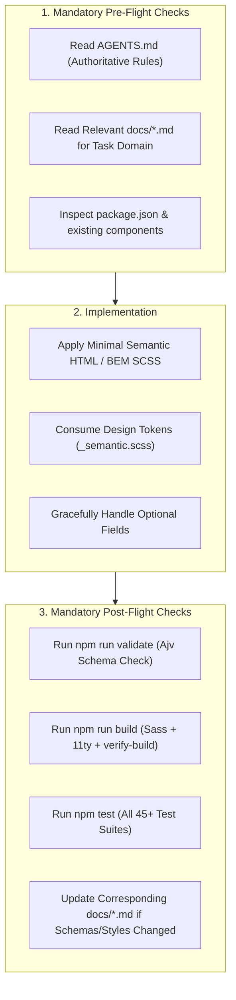

# AGENTS.md — Authoritative Architecture & Agent Directives

> **SINGLE SOURCE OF TRUTH**: This document is the primary, authoritative directive for all AI coding agents (**Antigravity**, **Claude Code**, **Cursor**, **GitHub Copilot**, **ChatGPT**, **Windsurf**, and related LLM tooling) and human contributors working in this repository.
> When any other documentation, prompt, or external guideline conflicts with this document, **AGENTS.md takes absolute precedence**.

---

## 1. Core Architectural Invariants (Non-Negotiable)

Every contribution MUST honor these five foundational invariants:

### 1.1 Pure Static Output Lock
- **Static Pre-Rendering Only**: All production output must be 100% pre-rendered static HTML and CSS generated at build time via **Eleventy (11ty) v3.x** and **Dart Sass**.
- **0 KB Runtime Frameworks**: NEVER introduce client-side frameworks or runtime hydration libraries (e.g., React, Vue, Svelte, Preact, Alpine.js, HTMX) solely for component rendering.
- **No SSR / Server Dependencies**: The site must deploy as pure static files to Netlify or Cloudflare Pages with zero required serverless functions, Edge functions, or node server runtime in production.
- **Build-Time Storyblok Execution**: Storyblok Content Delivery API calls occur strictly at build time (`src/_data/storyblok.js`). NEVER make client-side Storyblok API requests in production. The Storyblok Bridge (`storyblok-bridge.js`) is strictly isolated and loads ONLY when previewing inside the Storyblok Visual Editor iframe (`?_storyblok=...`).
- **Zero Token Leaks**: NEVER expose or inject `STORYBLOK_TOKEN`, API keys, or private environment variables into production HTML `<meta>` tags, data attributes, inline scripts, or client bundles.

### 1.2 Schema & Content-Model Lock
- **Schema Conformity**: All components, local data files (`src/_data/site.json`), and CMS stories must conform strictly to [`docs/CONTENT-MODEL.md`](./docs/CONTENT-MODEL.md), [`content.schema.json`](./content.schema.json), and [`storyblok/components.json`](./storyblok/components.json).
- **Graceful Nullability & Fallbacks**: Components MUST gracefully handle optional, empty, or undefined CMS fields (such as `bio`, `icon`, `image`, `description`, `details`, `kidsLabel`, `actionLabel`) without breaking markup, throwing Nunjucks template errors, or rendering `[object Object]`.
- **Button Icon & Font Awesome Invariant**: All button components (`link_button`, `dropdown_card`, `donation_card`) MUST support arbitrary Font Awesome icons (`fa-*`, `fa-solid`, `fa-brands`, `fas`, `far`, `fab`, or short names like `cross`, `star`, `ticket`, `coffee`, `bible`, `church`, `calendar`), raw inline SVG markup, and `<i>` icon tags via the self-hosted [`src/_includes/components/FaIcon.njk`](./src/_includes/components/FaIcon.njk) component without loading external CDNs (preserving DSGVO zero third-party origin compliance).
- **Image Box & Media Links Invariant**: Media cards (`image_card_horizontal`, `image_card_vertical`) MUST support dual image input representations: structured image asset objects (`{ filename }` or `{ src, alt, width, height }`) AND direct URL/path strings (`localAsset` or `safeUrl`). The `label` field is optional; omitting it renders a full-card clickable image banner without an empty title container.
- **Offline Fallback Guarantee**: The build pipeline must succeed completely from local offline data (`src/_data/site.json`, `src/_data/operator.json`) whenever `STORYBLOK_TOKEN` is unset or the Storyblok API is unreachable.
- **Dual-Tier Curation**:
  - *Tier 1 (`display_in_default` / `displayInDefault`)*: Curates the default landing page (`/`). When `false`, the item is omitted from `/`.
  - *Tier 2 (`show_on` / `hide_on`)*: Targets specific campus or channel routes (`gifhorn`, `wolfsburg`, `helmstedt`, `instagram`).

### 1.3 German Privacy / DSGVO Guardrail
- **Zero Initial Third-Party Connections**: On initial page visit, the browser MUST NOT contact any third-party origin. No Google Fonts, no external CDNs, no remote tracking pixels, and no analytics scripts.
- **Self-Hosted Assets**: All fonts (`Clash Display`, `Inter`), images, icons, and stylesheets MUST be self-hosted in `src/assets/` and served locally.
- **No Initial Cookies or Trackers**: No non-essential cookies, `localStorage`, `sessionStorage`, or device fingerprinting. The site must be 100% functional without requiring an intrusive cookie consent banner on landing.
- **2-Click Consent YouTube Facade**: Direct YouTube `<iframe>` embeds are strictly forbidden on initial load. Videos must render a static thumbnail facade (`video-embed.js`, < 1.5 KB). An iframe is dynamically injected ONLY upon an explicit user play click, loading exclusively from `https://www.youtube-nocookie.com`.
- **Mandatory Privacy Ledger Compliance**: Any modification introducing a new network origin MUST be documented in [`docs/PRIVACY-DEPENDENCIES.md`](./docs/PRIVACY-DEPENDENCIES.md) and approved against [`docs/LEGAL-PRIVACY-DE.md`](./docs/LEGAL-PRIVACY-DE.md).

### 1.4 Brand Color Constancy Invariant & Official Brand Assets
- **Immutable Color Palette**: Brand colors (`#08415C` Dark Teal Blue, `#846B8A` Muted Lavender, `#FEFADC` Light Pastel Yellow) must **never** change based on URL parameters, surfaces, campus routes (`/gf`, `/wob`, `/he`), or sublinks.
- **Content Filtering Only**: Surfaces and campus switches filter content visibility only; they never alter brand styling, button action fills, or typography tokens.
- **Brand Logos & Media Assets Location**: All verified brand assets, official logos, and campus photography are self-hosted in [`src/assets/images/`](./src/assets/images):
  - Primary Logo: [`src/assets/images/logo.svg`](./src/assets/images/logo.svg) (Dark teal geometric mark, default avatar).
  - Web Favicon: [`src/assets/images/favicon.webp`](./src/assets/images/favicon.webp).
  - Avatar Placeholder: [`src/assets/images/avatar.svg`](./src/assets/images/avatar.svg).
  - Campus & Banner Photography: `src/assets/images/echo-home-gifhorn-1024x682.webp`, `src/assets/images/echo-home-helmstedt-803x1024.webp`, `src/assets/images/echo-home-wolfsburg-1024x666.webp`, `src/assets/images/es26-hero-1-1536x864.webp`.
  - Fallback SVGs: `photo-vertical.svg`, `project-horizontal.svg`, `video-thumbnail.svg`.
  - See [`docs/STYLEGUIDE.md#4-logo--media-rules`](./docs/STYLEGUIDE.md) for the complete asset inventory table, dimensions, and Schutzzone rules.

### 1.5 Pure CSS Interactivity, Token Pairing & Accessibility (WCAG 2.2 AA)
- **Zero-JS Collapsible Interactivity**: Interactive disclosures (e.g., `DropdownCard` service times) MUST use native HTML5 `
` and `
` elements with pure CSS transitions.
- **Strict Token Pairing**: Background colors must never be applied in isolation without an explicitly declared paired foreground/icon color. Follow `--color-[surface]` and `--color-on-[surface]` semantics (see [`docs/STYLEGUIDE.md#8-color-contrast-token-pairing--automated-css-testing`](./docs/STYLEGUIDE.md)).
- **Keyboard & Contrast Compliance**: All interactive elements must provide visible `:focus-visible` focus rings and maintain a minimum contrast ratio of 4.5:1 for normal text (3:1 for large text / interactive UI).
- **Reduced Motion**: All animations must respect `@media (prefers-reduced-motion: reduce)`.
- **Accessibility (a11y) Component Suite & Preferences Modal**:
  - *Skip-to-Content*: All base templates MUST render `<a href="#content" class="a11y-button a11y-button--skip">` at the start of `<body>`. It remains hidden offscreen until keyboard-focused.
  - *Floating Access Trigger*: A persistent floating pill button (`.a11y-button--floating`) at bottom-right opens the preferences popup via `aria-controls="a11y-modal"`.
  - *HTML5 `<dialog class="a11y-modal">`*: Fully accessible modal for user display preferences. Must use fixed viewport centering (`position: fixed; inset: 0; z-index: 99999; inline-size: 100vw; block-size: 100vh;`) to prevent mobile fallback rendering at document bottom. Must lock background scrolling (`document.body.style.overflow = 'hidden'`) while open.
  - *Font Scaling*: Supports 3 discrete levels via `html[data-font-size="normal|large|xlarge"]` (100%, 115%, 130%).
  - *High Contrast Modes*: Supports `[data-contrast="black-on-white"]` and `[data-contrast="white-on-black"]` (providing 21:1 WCAG AAA contrast ratio) with automatic avatar logo inversion. Reversion to `normal` restores the active brand theme.
  - *Test Page Verification*: The `/test/index.html` route MUST provide operational test controls (`#a11y-test-skip`, `#a11y-test-contrast-toggle`, `#a11y-test-modal-trigger`) and live status badges (`#active-contrast-badge`, `#active-font-size-badge`) verified across Mobile, DOM, and Desktop viewports.

---

## 2. Coding Standards & Conventions

### 2.1 CSS & BEM Architecture
- **Strict BEM Naming**: All CSS classes must follow the BEM (`Block__Element--Modifier`) naming convention (e.g., `.link-card`, `.link-card__title`, `.link-card--horizontal`).
- **No ID Selectors**: Never use ID selectors (`#id`) for CSS styling.
- **Tokens First**: Never hardcode hex colors or spacing values in component stylesheets. Always consume semantic CSS custom properties defined in `src/styles/tokens/_semantic.scss` (e.g., `var(--color-action-bg)`, `var(--color-text)`, `var(--color-page-bg)`).
- **Mobile-First**: Author CSS mobile-first, using `min-width` media queries for desktop enhancements.
- **Selector Depth**: Avoid nesting deeper than 3 levels in SCSS.

### 2.2 Minimal & Semantic HTML
- **Semantic Tags**: Use proper HTML5 semantic elements (`<header>`, `<main>`, `<nav>`, `<section>`, `<article>`, `<footer>`, `
`, `
`).
- **Minimal DOM Tree**: Omit redundant wrapper `
` elements, unused container wrappers, and dead boilerplate.
- **Safe URLs**: All dynamic URLs must pass through the `resolveUrl` Nunjucks filter to sanitize against dangerous `javascript:` and `data:` protocols.

### 2.3 Dependencies & Library Policy
- **Don't Reinvent the Wheel**: Do not rewrite functionality already provided by standard JS frameworks or established libraries—import and use them instead when appropriate.
- **Vet External Packages**: Only install well-known, actively maintained libraries with strong community adoption (high GitHub stars and weekly downloads).
- **Avoid Micro-Dependencies**: NEVER install trivial, one-liner packages (e.g., `is-odd`, `left-pad`, or whitespace utilities). Write simple utility functions natively.
- **Production Client-Side JS Budget**: Target 0 KB production JS. Any client-side script must be justified, self-contained vanilla JS (< 1.5 KB), and pass `scripts/verify-build.mjs`.

### 2.4 Git & Commit Conventions
- **Conventional Commits**: All commit messages must follow the Conventional Commits specification:
  - `feat:` A new feature or component
  - `fix:` A bug fix or schema correction
  - `refactor:` Code restructuring without functional changes
  - `style:` Design token, formatting, or CSS updates
  - `docs:` Documentation or agent instruction changes
  - `test:` Adding or updating test suites
  - `chore:` Dependency updates, build script adjustments

---

## 3. Explicit "DO" and "DO NOT" Rules

### DO:
- **DO** compile Sass via `npm run build:sass` into the single output `_site/css/main.css`.
- **DO** test both local fallback data (`npm run validate`) and Storyblok synchronization schemas before committing.
- **DO** maintain the exact "e" clear space (*Schutzzone*) on all four sides of the Echo logo.
- **DO** locate and reference brand logos and media assets in `src/assets/images/` as cataloged in [`docs/STYLEGUIDE.md#4-logo--media-rules`](./docs/STYLEGUIDE.md).
- **DO** strictly pair all background tokens with their corresponding `--color-on-*` foreground tokens.
- **DO** maintain the pre-rendered skip-to-content link targeting `#content` and floating a11y trigger across all base templates.
- **DO** preserve high contrast and font scaling token contracts and ensure test mode controls function across mobile, DOM, and desktop.
- **DO** compress and convert all uploaded images to `.webp` format (max 400 KB, 1900px max width for heroes, 1400px for cards).
- **DO** keep operator legal identity in `src/_data/operator.json` and maintain canonical external legal links to `https://kirche-echo.de/impressum/` and `https://kirche-echo.de/datenschutz/`.
- **DO** use repository-relative markdown links (e.g. `[./docs/STYLEGUIDE.md](./docs/STYLEGUIDE.md)`) for all documentation and asset references.
- **DO** run `npm run build && npm test` and ensure all test assertions pass.

### DO NOT:
- **DO NOT** serve `/impressum` or `/datenschutz` as local routes on this domain; they must be external links pointing to `https://kirche-echo.de/...`.
- **DO NOT** commit absolute machine-specific file URIs (`file:///Users/...`) or local environment paths into markdown documentation.
- **DO NOT** delete, rename, or archive documentation files without explicit user review.
- **DO NOT** install client-side UI frameworks (React, Vue, Svelte, Alpine) or hydration scripts.
- **DO NOT** break `.a11y-modal` fixed viewport centering or allow mobile background scrolling while the modal is open.
- **DO NOT** make client-side network calls to the Storyblok API in production.
- **DO NOT** add external fonts (`fonts.googleapis.com`, Adobe Fonts) or third-party tracking scripts.
- **DO NOT** use YouTube `<iframe>` tags directly in Nunjucks templates without the 2-click consent facade.
- **DO NOT** alter brand identity colors based on URL parameters, campus routes, or query strings.
- **DO NOT** hardcode production credentials or legal operator placeholders in public examples.

---

## 4. Mandatory Pre-Flight & Post-Flight Checklists

All agents MUST execute these checks for every code modification:

### Pre-Flight Checklist (Before Writing Code)
1. Read this [`AGENTS.md`](./AGENTS.md) file to internalize active constraints.
2. Read the domain-specific documentation file:
   - For components/markup: [`docs/CONTENT-MODEL.md`](./docs/CONTENT-MODEL.md) and [`docs/STORYBLOK.md`](./docs/STORYBLOK.md).
   - For styling/tokens: [`docs/STYLEGUIDE.md`](./docs/STYLEGUIDE.md).
   - For routing/surfaces: [`docs/ARCHITECTURE.md`](./docs/ARCHITECTURE.md).
   - For privacy/embeds: [`docs/LEGAL-PRIVACY-DE.md`](./docs/LEGAL-PRIVACY-DE.md) and [`docs/PRIVACY-DEPENDENCIES.md`](./docs/PRIVACY-DEPENDENCIES.md).
   - For build/deployment: [`docs/DEPLOYMENT.md`](./docs/DEPLOYMENT.md).

### Post-Flight Checklist (Before Reporting Completion)
1. Run `npm run validate` → JSON Schema validation must pass.
2. Run `npm run build` → Sass compilation, Eleventy build, and `verify-build.mjs` must pass.
3. Run `npm test` → All test suites must pass with 0 failures.
4. Verify zero forbidden items were introduced (no remote fonts, no initial `<iframe>`, no unauthorized JS).
5. If any component schema, design token, dependency, or routing rule was altered, update the corresponding documentation file in `docs/` in the same commit.

---

## 5. Master Documentation Index & Tool Alignment

| Target File | Intended Role & Scope |
| :--- | :--- |
| [`AGENTS.md`](./AGENTS.md) | **Single Source of Truth** for all agent directives, constraints, and quality standards. |
| [`README.md`](./README.md) | Human-facing project overview, technical architecture, and documentation directory. |
| [`ANTIGRAVITY.md`](./ANTIGRAVITY.md) | Operational execution guide for Antigravity agents. References `AGENTS.md`. |
| [`CLAUDE.md`](./CLAUDE.md) | Operational guidelines for Claude Code agents. References `AGENTS.md`. |
| [`.cursorrules`](.cursorrules) | Cursor IDE AI rules enforcing styleguide and architecture. References `AGENTS.md`. |
| [`.github/copilot-instructions.md`](.github/copilot-instructions.md) | GitHub Copilot prompt directives. References `AGENTS.md`. |
| [`SKILLS.md`](./SKILLS.md) | Reusable task-oriented procedural library for specific development tasks. |
| [`STORYBLOK-STARTER-GUIDE.md`](./STORYBLOK-STARTER-GUIDE.md) | Step-by-step onboarding guide for church editors setting up a new Storyblok space. |
| [`docs/ARCHITECTURE.md`](./docs/ARCHITECTURE.md) | Complete system architecture, data flows, routing mechanics, and security headers. |
| [`docs/CONTENT-MODEL.md`](./docs/CONTENT-MODEL.md) | Production specification for Storyblok blok schemas and local fallback data. |
| [`docs/STYLEGUIDE.md`](./docs/STYLEGUIDE.md) | Authoritative visual design system: logo & media inventory (`src/assets/images/`), typography, colors, logo clear space, token pairing, and WCAG contrast rules. |
| [`docs/DEPLOYMENT.md`](./docs/DEPLOYMENT.md) | Static hosting, Netlify build hooks, webhook rebuilds, and caching policies. |
| [`docs/LEGAL-PRIVACY-DE.md`](./docs/LEGAL-PRIVACY-DE.md) | German/EU legal compliance requirements (DDG §5 Impressum, DSGVO Datenschutz). |
| [`docs/PRIVACY-DEPENDENCIES.md`](./docs/PRIVACY-DEPENDENCIES.md) | Ledger of approved third-party network origins. |
| [`docs/STORYBLOK.md`](./docs/STORYBLOK.md) | Bilingual (EN/DE) reference for all 12 Storyblok components and Visual Editor. |
