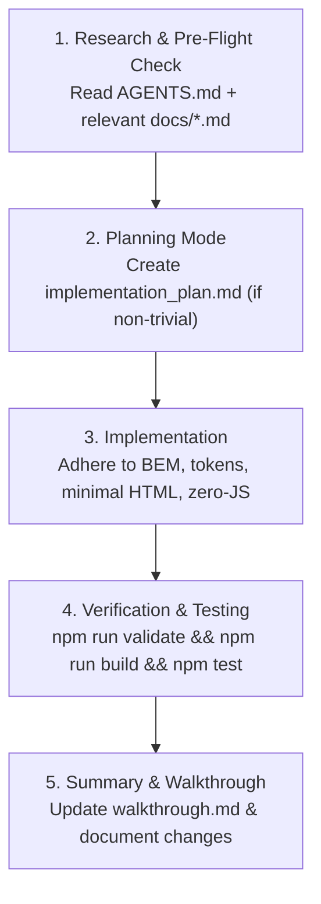

# Antigravity Agent Operational Brief — Echo Link-Tree

This document provides operational guidance for Google Antigravity agents working in the `link-tree` repository.

> **RULE OF PRECEDENCE**: [`AGENTS.md`](./AGENTS.md) is the authoritative Single Source of Truth for all architectural rules, "DO / DO NOT" constraints, privacy guardrails, and coding conventions. This document specifies tool workflows and execution protocols for Antigravity.

---

## 1. Antigravity Agent Lifecycle & Workflow

When assigned a task in this repository, follow this structured execution protocol:



### Step 1: Pre-Flight Document Check
Before modifying any files:
1. Review [`AGENTS.md`](./AGENTS.md) for non-negotiable invariants.
2. Read the domain-specific documentation file:
   - Components & Schemas: [`docs/CONTENT-MODEL.md`](./docs/CONTENT-MODEL.md) and [`docs/STORYBLOK.md`](./docs/STORYBLOK.md)
   - Design System & Tokens: [`docs/STYLEGUIDE.md`](./docs/STYLEGUIDE.md)
   - Routing & Architecture: [`docs/ARCHITECTURE.md`](./docs/ARCHITECTURE.md)
   - Privacy & Embeds: [`docs/LEGAL-PRIVACY-DE.md`](./docs/LEGAL-PRIVACY-DE.md) and [`docs/PRIVACY-DEPENDENCIES.md`](./docs/PRIVACY-DEPENDENCIES.md)
   - Deployment & Caching: [`docs/DEPLOYMENT.md`](./docs/DEPLOYMENT.md)

### Step 2: Planning Mode & User Approval
- For non-trivial modifications (new components, schema migrations, routing changes, architectural adjustments), create or update `implementation_plan.md` in the artifact directory before modifying code.
- Wait for user confirmation or proceed when instructed.

### Step 3: Implementation
- **Strict BEM**: Apply BEM naming for all CSS classes (`.block__element--modifier`).
- **Design Tokens**: Consume CSS variables from `src/styles/tokens/_semantic.scss`.
- **Pure CSS Interactivity**: Collapsible UI must use HTML5 `<details>` and `<summary>`.
- **Zero Client Frameworks**: Never introduce React, Vue, Svelte, Alpine, or hydration scripts.
- **Strict Iconography**: Never create custom icons; use Font Awesome icons via `FaIcon.njk` (the only custom icons are official logos).
- **Graceful Nullability**: Ensure all components render cleanly if optional CMS fields are missing.

### Step 4: Verification Commands
Execute the complete verification pipeline inside `link-tree`:

```bash
# 1. Validate content against JSON Schema
npm run validate

# 2. Compile Sass design tokens to _site/css/main.css
npm run build:sass

# 3. Compile static HTML with Eleventy
npm run build:eleventy

# 4. Enforce bundle budget and scan for unauthorized scripts/iframes
node scripts/verify-build.mjs

# 5. Run full automated test suite (55+ tests across markup, routing, states)
npm test
```

### Step 5: Post-Flight Documentation Sync
- If a component schema changed, update [`storyblok/components.json`](./storyblok/components.json), [`content.schema.json`](./content.schema.json), and [`docs/CONTENT-MODEL.md`](./docs/CONTENT-MODEL.md).
- If a style token changed, update `src/styles/tokens/` and [`docs/STYLEGUIDE.md`](./docs/STYLEGUIDE.md).
- If an external network origin was introduced, update [`docs/PRIVACY-DEPENDENCIES.md`](./docs/PRIVACY-DEPENDENCIES.md).
- Create or update `walkthrough.md` to document changes and test verification results.

---

## 2. Decision Hierarchy

When faced with trade-offs or ambiguous requirements, prioritize in this strict order:
1. **Privacy & Security**: Zero third-party connections on load, no data leaks, no client tokens.
2. **Zero Runtime JavaScript**: Favor static HTML and pure CSS over client-side JS.
3. **Architectural Constancy**: Never modify brand colors based on URL parameters or surfaces.
4. **Accessibility (WCAG 2.2 AA)**: Semantic elements, `:focus-visible` states, contrast ratios.
5. **Portability**: Pure static output ready for Netlify or Cloudflare Pages with zero server dependencies.
