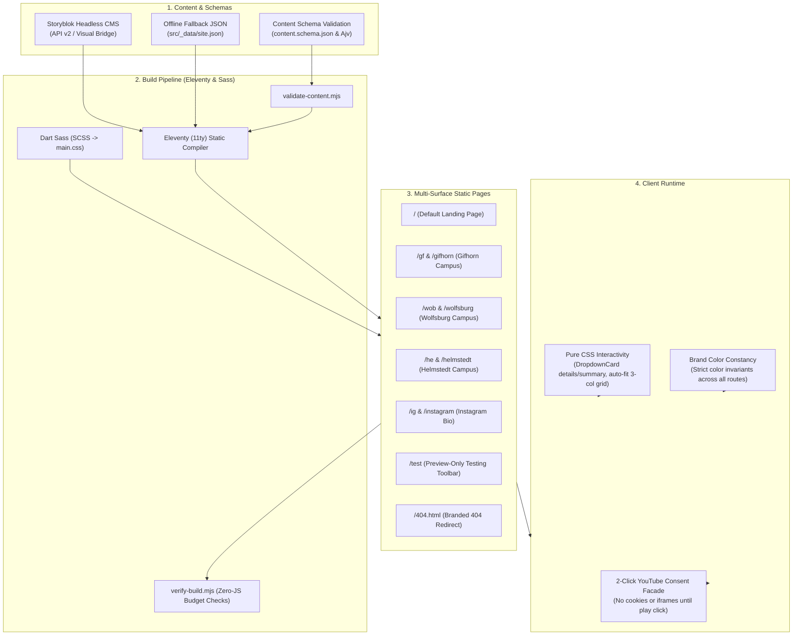

# Echo Link-Tree

[](./LICENSE)
[](https://kirche-echo.de)
[](./docs/LEGAL-PRIVACY-DE.md)

A high-performance, static-first, privacy-compliant link-in-bio platform for churches, mission organizations, and non-profits. Features Storyblok headless CMS visual editing, multi-location campus routing, and pure-CSS accessible components. Free and open source for ministries and charities worldwide.

---

## Quick Start: Git & AI Agent Setup

### 1. How to Clone This Repository
```bash
# Clone the upstream repository
git clone https://github.com/subinamathew/link-tree.git
cd link-tree

# OR clone your personal fork (replace <YOUR_USERNAME> with your GitHub handle)
git clone https://github.com/<YOUR_USERNAME>/link-tree.git
cd link-tree
```

### 1b. How to Get a GitHub Account, Username & Personal Access Token (PAT)
```bash
# 1. Sign up for a free GitHub account (your username is chosen during signup)
open https://github.com/join

# 2. Generate a Personal Access Token (PAT) with 'repo' scope
open https://github.com/settings/tokens
```

### 1c. How to Login to Git and Set Username & Password / Token
```bash
# Set your Git commit identity
git config --global user.name "<YOUR_GITHUB_USERNAME>"
git config --global user.email "<YOUR_EMAIL@EXAMPLE.COM>"

# Cache credentials in keychain (use your PAT as the password when prompted)
git config --global credential.helper osxkeychain   # macOS
# git config --global credential.helper store       # Linux / Windows

# OR log in interactively via GitHub CLI (recommended)
gh auth login
```

### 2. How to Import into AI Agents
```bash
# Navigate to the project directory
cd link-tree

# Launch with your agent environment or open as active workspace
claude       # Claude Code
cursor .     # Cursor IDE
code .       # VS Code / GitHub Copilot
# Antigravity: Open the 'link-tree' folder as your active Workspace
```

### 3. What is the First Command to Agents
```bash
# Shell command for initial setup and pre-flight verification
npm install && npm run validate && npm run build && npm test
```

```text
# First prompt instruction to send your AI agent:
Read AGENTS.md and docs/STYLEGUIDE.md to internalize all architectural rules, then run: npm run validate && npm run build && npm test
```

---

## 1. Master Documentation Index & File Purpose Mapping

> ⚠️ **FILE INTEGRITY GUARDRAIL FOR ALL AGENTS & CONTRIBUTORS**:
> **DO NOT** delete, rename, or archive any documentation file without explicit user approval. Every file in this table serves a dedicated, non-overlapping purpose within the project's guardrail system.

| File Path | Target Audience / Purpose | Authoritative Scope |
| :--- | :--- | :--- |
| [`AGENTS.md`](./AGENTS.md) | **All AI Agents & Developers** | **Single Source of Truth** for strict architectural rules, non-negotiable DO/DO NOT constraints, static-site locks, schema locks, privacy rules, BEM CSS, Conventional Commits, and pre/post-flight checks. |
| [`README.md`](./README.md) *(This file)* | **Developers & Contributors** | Primary project overview, architecture diagram, master documentation index, build commands, and testing guidelines. |
| [`ANTIGRAVITY.md`](./ANTIGRAVITY.md) | **Antigravity AI Agent** | Tool-specific operational workflows, pre-flight verification, testing commands, and artifact protocols for Antigravity. |
| [`CLAUDE.md`](./CLAUDE.md) | **Claude Code Agents** | Tool-specific operational guidelines, verification steps, and quick references for Claude Code. |
| [`.cursorrules`](.cursorrules) | **Cursor IDE & AI Tools** | Cursor prompt configuration enforcing BEM, styleguide, and static-first architecture. |
| [`.github/copilot-instructions.md`](.github/copilot-instructions.md) | **GitHub Copilot** | Copilot code completion and workspace directives. |
| [`SKILLS.md`](./SKILLS.md) | **All Agents (Task Library)** | Reusable procedural recipes for 10 discrete engineering tasks (adding components, updating schemas, privacy reviews). |
| [`STORYBLOK-STARTER-GUIDE.md`](./STORYBLOK-STARTER-GUIDE.md) | **Human Content Editors & Onboarding** | Step-by-step onboarding guide for church staff to create a free Storyblok space, generate API tokens, and configure the Surfaces datasource. |
| [`docs/ARCHITECTURE.md`](./docs/ARCHITECTURE.md) | **Technical Architects & Engineers** | Deep technical architecture blueprint, Eleventy pipeline, data flow, CSP headers, and bundle budget breakdown. |
| [`docs/CONTENT-MODEL.md`](./docs/CONTENT-MODEL.md) | **Engineers & CMS Integrators** | Complete production content model specification for both Storyblok blok schemas and local `content.schema.json`. |
| [`docs/DEPLOYMENT.md`](./docs/DEPLOYMENT.md) | **DevOps & Release Engineers** | Production hosting contracts, Netlify build hooks, webhook publishing, and static cache policies. |
| [`docs/LEGAL-PRIVACY-DE.md`](./docs/LEGAL-PRIVACY-DE.md) | **Legal & Privacy Compliance** | German/EU regulatory compliance (DDG §5 Impressum, DSGVO Datenschutz, zero cookies, 2-click consent). |
| [`docs/PRIVACY-DEPENDENCIES.md`](./docs/PRIVACY-DEPENDENCIES.md) | **Security & Privacy Auditing** | Ledger of all permitted third-party network origins (initial load: none; on-click: YouTube privacy mode). |
| [`docs/STORYBLOK.md`](./docs/STORYBLOK.md) | **Content Editors & Developers** | Complete bilingual (English & Einfaches Deutsch) reference for all 12 Storyblok components and visual editing bridge. |
| [`docs/STYLEGUIDE.md`](./docs/STYLEGUIDE.md) | **UI/UX Designers & Frontend Devs** | Echo Kirche design tokens, type scale, color invariants, logo clear space, media budgets, and BEM standards. |

---

## 2. System Architecture



---

## 3. Coding Standards & Conventions

All contributors and AI agents must adhere to these established standards:
- **Strict Patterns**: Adhere strictly to established architectural patterns, folder structures, and conventions in the codebase.
- **Git Commits**: Follow Conventional Commits specification (`feat:`, `fix:`, `chore:`, `refactor:`, `style:`, `docs:`, `test:`).
- **CSS / BEM**: Use strict BEM (`Block__Element--Modifier`) naming conventions for all CSS classes. Never use ID selectors for styling.
- **Minimal HTML**: Keep HTML semantic and minimal. Omit redundant wrapper elements, unused attributes, and boilerplate bloat.
- **Dependencies & Libraries**:
  - **Don't Reinvent the Wheel**: Do not rewrite functionality already provided by standard JS frameworks or established libraries—import and use them instead.
  - **Vet External Packages**: Only install well-known, actively maintained libraries with strong community adoption (high GitHub stars and weekly downloads).
  - **Avoid Micro-Dependencies**: Never install trivial, one-liner packages (`is-odd`, `left-pad`, whitespace utilities). Write simple utility functions natively.

---

## 4. Key Architectural Features

- **Multi-Location Surface Routing**: Dedicated static routes (`/gf`, `/gifhorn`, `/wob`, `/wolfsburg`, `/he`, `/helmstedt`, `/ig`, `/instagram`) generated at build time with clean canonical URLs.
- **Preview vs. Production Security**: The `/test` page with interactive surface and theme switchers is strictly reserved for preview mode and redirected to `/` in production via Netlify config.
- **Brand Color Constancy**: Strict adherence to the Echo brand palette (`#08415C` Dark Teal Blue, `#846B8A` Muted Lavender, `#FEFADC` Light Pastel Yellow) across all routes. City switches filter content without changing brand colors.
- **Collapsible Service Times Card (`DropdownCard`)**:
  - Implemented with pure CSS `<details>` / `<summary>` (100% accessible, zero client-side JavaScript required).
  - Responsive 3-column auto-fit grid (`repeat(auto-fit, minmax(200px, 1fr))`) that stacks gracefully on mobile.
  - Fully editable mini cards (`title`, `time`, `location`, `details`, `url`, `actionLabel`, `hasKids`, `kidsLabel`).
  - Built-in **Echo Kids available** indicator badge with inline child SVG icon.
- **Dual-Tier Content Curation**:
  - **Tier 1 (`display_in_default`)**: Boolean switch on every component to curate the default homepage (`/`) independently.
  - **Tier 2 (`show_on` / `hide_on`)**: Target components to specific campus routes (`gifhorn`, `wolfsburg`, `helmstedt`, `instagram`).
- **Accessibility (a11y) Suite & Responsive Preferences Modal**:
  - Pre-rendered skip-to-content anchor (`<a href="#content" class="a11y-button a11y-button--skip">`) targeting the main content area for keyboard navigation.
  - Persistent floating trigger button (`.a11y-button--floating`) providing instant access to the preferences popup.
  - Native HTML5 `<dialog class="a11y-modal">` for font scaling (100%, 115%, 130%) and 21:1 WCAG AAA high-contrast modes (`black-on-white`, `white-on-black`).
  - Viewport-fixed positioning (`position: fixed; inset: 0; z-index: 99999`) and background scroll locking (`overflow: hidden`) for seamless mobile, DOM, and desktop operation.
  - Dedicated interactive testing toolbar on `/test` with live status badges.
- **Privacy-First (GDPR / DSGVO Compliant)**:
  - Zero cookies on initial page visit (no cookie banner required).
  - 2-click consent YouTube video player facade (`video-embed.js`, < 1.5 KB): YouTube iframes load only after an explicit user click, using `youtube-nocookie.com`.
- **Headless Storyblok Integration**:
  - Visual Editor bridge for live inline editing in the browser.
  - Offline local fallback data in `src/_data/site.json` ensures development and builds never fail if the API is unreachable.
  - 12 fully declared Storyblok components in `storyblok/components.json`.

---

## 5. Component Hierarchy

```
link_page (Page Root)
├── a11y_button--skip (Pre-rendered skip-to-content keyboard anchor)
├── profile_header (Logo avatar, church name, bio tagline)
├── body (Ordered list of content blocks)
│   ├── link_button (Full-width button with custom icon)
│   ├── dropdown_card (Collapsible service times card)
│   │   └── dropdown_time_item (Service mini cards with time & Echo Kids badge)
│   ├── image_card_horizontal (16:9 featured horizontal card with title & arrow)
│   ├── image_card_vertical (3:4 portrait flyer card with title & arrow)
│   ├── video_link_card (Privacy 2-click video card with YouTube ID support)
│   ├── group_block (Container box for grouping nested buttons and cards)
│   └── section_heading (Uppercase category divider)
├── a11y_button--floating (Persistent bottom-right accessibility trigger)
├── a11y_modal (HTML5 dialog for font scaling & 21:1 high contrast modes)
└── footer_legal (Organization info, Impressum & Datenschutz links, social buttons)
    └── social_item (Circular icon buttons for Instagram, YouTube, Spotify, WhatsApp)
```

---

## 6. Development & Build Commands

```bash
# Install dependencies
npm install

# Start local development server (live reloading with Eleventy & Sass)
npm run dev

# Validate data against JSON Schema (Ajv)
npm run validate

# Production build (Validate -> Compile Sass -> Build Eleventy -> Verify output)
npm run build

# Run automated test suites (45+ tests across markup, states, and routes)
npm test

# Push component schemas to Storyblok Space
npx storyblok push-components storyblok/components.json --space <YOUR_SPACE_ID>

# Pull component schemas from Storyblok Space
npx storyblok pull-components --space <YOUR_SPACE_ID>
```

---

## 7. License & Community Dedication

This project is licensed under the **MIT License** — see the [`LICENSE`](./LICENSE) file for details.

### Free for Churches, Mission Organizations & Non-Profits
This platform is completely free and open-source for churches, Christian ministries, mission organizations, charities, and non-profits worldwide to fork, customize, and deploy.

---

Created with ❤️ : The Missional Company ([missional.eu](https://missional.eu))

