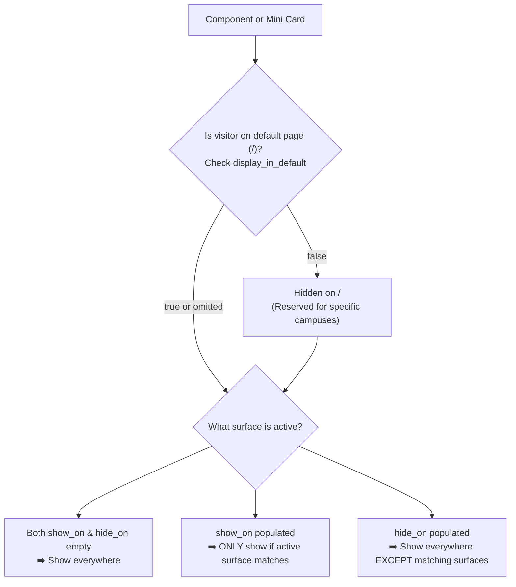

# Storyblok Starter Setup Guide — link-tree

> **RULE OF PRECEDENCE**: [`AGENTS.md`](./AGENTS.md) is the authoritative Single Source of Truth for architectural rules, DO/DO NOT constraints, and quality standards. For the bilingual in-depth component reference manual, see [`docs/STORYBLOK.md`](./docs/STORYBLOK.md).

This is the comprehensive, step-by-step setup guide for creating, configuring, and maintaining the **Echo Link-Tree** in Storyblok.

It is written for anyone who has **never used Storyblok before**, adheres strictly to the **Storyblok Starter (Free) plan** (1 editor seat, 0 extra costs), and documents every single component, field, reason, type, default, and surface rule.

> **Important**: Storyblok often starts a new space with a temporary paid trial. This guide intentionally uses only permanent features available on the free Starter plan so that your site continues working reliably after the trial expires.

---

## 0. What this project is doing

Storyblok functions as the **headless Content Management System (CMS)**.

The website itself is compiled by **Eleventy (11ty)** into pure, lightning-fast static HTML/CSS files. Storyblok delivers the raw content: church name, profile bio, action buttons, service times, images, videos, groups, and legal footer info.

### Architectural Core Principles
1. **Static-First**: Content is fetched from Storyblok during the build. Regular visitors receive instant static HTML without running heavy CMS JavaScript.
2. **Privacy-First (GDPR / DSGVO)**: Zero tracking cookies, zero external fonts (all fonts are hosted locally), and zero initial third-party connections. No cookie banner is required on initial visit.
3. **2-Click YouTube Consent**: YouTube videos load a local/uploaded thumbnail first. An embed iframe is only created after an explicit user click on the play button, using YouTube Privacy-Enhanced Mode (`youtube-nocookie.com`).
4. **Brand Color Constancy & Official Styleguide**:
   - **Colors**: Primary Teal (`#08415C`), Secondary Lavender (`#846B8A`), Background Pastel Yellow (`#FEFADC`).
   - **Typography**: `Clash Display` (600 Semibold) for headings & sub-brand wordmarks; `Inter` (400 Regular) for body/UI text.
   - **Sub-Brand Logo Rule**: When displaying the sub-brand text logo, **echo** is set in `Clash Display Semibold` (`600`) and **kids** is set in `Clash Display Regular` (`400`).
   - **Logo Clear Space (*Schutzzone*)**: Maintained equal to the width/height of lowercase "e" from *echo* wordmark on all four sides. No text, buttons, or graphics may enter this zone. Never stretch, compress, rotate, or distort the logo.
   - **Media Budget & Subject Matter**: Upload `.webp` format only, **max 400KB** per image, max width **1900px** for heroes and **1400px** for standard cards (`16:9`, `3:2`, `4:3`, `3:4` aspect ratios). Subject matter: authentic photos of people, community, faces, and visible emotions.
   - Brand colors remain strictly invariant across all routes and views. City switches and surfaces filter content visibility only; they never alter brand styling or colors.
5. **Dual-Tier Curation**:
   - **Tier 1 (`display_in_default`)**: Curates the main landing page (`/`) independently.
   - **Tier 2 (`show_on` / `hide_on`)**: Targets components to specific campus routes (`gifhorn`, `wolfsburg`, `helmstedt`, `instagram`).

The technical blueprint is declared in:
[`storyblok/components.json`](./storyblok/components.json)

---

# PART A — Create the Storyblok Space

## Step 1 — Create or sign in to Storyblok
1. Open [storyblok.com](https://www.storyblok.com).
2. Sign in or create a free account.
3. Use the primary email that will manage the church's web links.
4. Keep the space to **one editor seat** to remain comfortably within the free tier.

## Step 2 — Create one Space
A **Space** is Storyblok's term for a project.
1. From the Storyblok dashboard, click **Create new space**.
2. Space Name: `Echo Link-Tree` (or your church/organization name).
3. Server Location / Region: Choose **EU** (Frankfurt) for optimal latency and DSGVO data residency.
4. Click **Create space**.

> **One Space Rule**: Use this **single space** for your entire church link ecosystem. Do not create separate spaces for Gifhorn, Wolfsburg, Helmstedt, or Instagram. Those are handled via **Surfaces** inside this one space.

## Step 3 — Stay compatible with Starter Free
To avoid unexpected charges or breaking after the trial period:
- ✅ **Use**: 1 Space, Content Delivery API, Visual Editor, Nestable Components, Assets, Datasources, Webhooks.
- ❌ **Do NOT use**: Storyblok Agents, paid SEO Meta Tags app, custom roles, multi-stage workflows, releases, pipelines, or GraphQL.

---

# PART B — Create the Access Tokens

## Step 4 — Create a Public Content Delivery token
Used by the production static build (e.g. on Netlify) to fetch **published** content.
1. In your Storyblok space, go to **Settings** (gear icon in the sidebar).
2. Click **Access Tokens**.
3. Click **New Access Token**.
4. Name: `Netlify Production`
5. Type: Select **Public** (Access: Read published content).
6. Click **Generate Token** and copy it safely.

## Step 5 — Create a Preview token (Optional for Visual Editor)
Used by local development and the Visual Editor to preview **draft** unpublished content.
1. Click **New Access Token**.
2. Name: `Visual Editor Preview`
3. Type: Select **Preview** (Access: Read draft & published content).
4. Click **Generate Token**.

---

# PART C — Create & Manage the Reusable Surfaces Datasource

## What is a Surface?
A **Surface** represents a target channel, audience, or campus location.
Instead of building separate websites for Gifhorn, Wolfsburg, Helmstedt, or Instagram, the site generates dedicated static routes from the same content tree:
- `/` → Default main landing page (for universal visitors)
- `/gf/` and `/gifhorn/` → Gifhorn campus visitors
- `/wob/` and `/wolfsburg/` → Wolfsburg campus visitors
- `/he/` and `/helmstedt/` → Helmstedt campus visitors
- `/ig/` and `/instagram/` → Instagram bio traffic
- `/test/` → Preview-only test page with live surface and theme switchers (hidden on production)

A Storyblok **Datasource** is a centralized, reusable list of key-value pairs. Using a datasource ensures that campus names and slugs are managed in one place and reused across all components.

## Step 6 — Create the Surfaces Datasource
1. In Storyblok, click **Datasources** in the left navigation.
2. Click **New Datasource**.
3. Name: `Surfaces`
4. Slug: `surfaces`
5. Click **Save**.

## Step 7 — Add the Standard Surface Entries
Click **Add Entry** and populate each row with the exact values below:

| Name (Display in Editor) | Value (Technical Slug) | Route Mapped | Purpose / Usage |
|---|---|---|---|
| `Default` | `default` | `/` | Standard landing page; universal links. |
| `Gifhorn (gf)` | `gifhorn` | `/gf/` & `/gifhorn/` | Gifhorn campus services & announcements. |
| `Wolfsburg (wob)` | `wolfsburg` | `/wob/` & `/wolfsburg/` | Wolfsburg campus services & announcements. |
| `Helmstedt (he)` | `helmstedt` | `/he/` & `/helmstedt/` | Helmstedt campus services & announcements. |
| `Instagram (ig)` | `instagram` | `/ig/` & `/instagram/` | Instagram bio links & social campaigns. |
| `TikTok` | `tiktok` | `?surface=tiktok` | TikTok bio campaigns. |
| `LinkedIn` | `linkedin` | `?surface=linkedin` | Professional/team content. |
| `YouTube` | `youtube` | `?surface=youtube` | Livestream/broadcast viewers. |

## Step 8 — How to Manage Surfaces Over Time

### Adding a New Surface
If you want to target a new campaign (e.g. *Easter Conference* or a *QR Code on a printed flyer*):
1. Open **Datasources → Surfaces**.
2. Click **Add Entry**.
3. **Name**: Enter a friendly label for editors (e.g. `Easter Conference (easter)` or `Printed Flyer (flyer)`).
4. **Value**: Enter a clean lowercase slug without spaces (e.g. `easter` or `flyer`).
5. Click **Save**.
6. The new option immediately appears in the `show_on` and `hide_on` dropdowns of all components!

### Slugs vs. Code Routes
- **Slugs (`value`)**: Must match lowercase alphanumeric letters and dashes.
- Visitors can view the surface dynamically on any page by adding the query parameter: `?surface=easter` or `?switch=easter`.
- If you later want a permanent static shortcut like `<domain>/easter/`, add that route to `src/_data/surfaces.js` in the repository.

### Renaming or Removing an Entry
- **Renaming the Name**: Safe at any time. It only changes what editors see in dropdown menus.
- **Changing the Value (Slug)**: ⚠️ Caution! If existing components were tagged with the old slug, update those components to use the new slug.

---

# PART D — Understanding show_on, hide_on & display_in_default

Every component in the system includes three targeting controls:



### The Rules Explained

#### 1. `display_in_default` (Boolean Switch)
- **Type**: `Boolean`
- **Default**: `true`
- **Reason**: Allows you to curate the default homepage (`/`) independently.
- **Rule**:
  - `true`: The item appears on the main homepage (`/`).
  - `false`: The item is hidden from `/`, allowing you to reserve location-specific items (like city switch buttons or specific campus photos) exclusively for their respective pages (`/gf`, `/wob`, `/he`).

#### 2. `show_on` (Allowlist)
- **Type**: `Multi-Option` (Storyblok `options`)
- **Source**: `surfaces` Datasource
- **Default**: Empty `[]`
- **Reason**: Restricts an item so it **ONLY** appears on selected surfaces.
- **Example**: A button set to `show_on = ["gifhorn"]` will only appear on `/gf` and `/gifhorn`.

#### 3. `hide_on` (Blocklist)
- **Type**: `Multi-Option` (Storyblok `options`)
- **Source**: `surfaces` Datasource
- **Default**: Empty `[]`
- **Reason**: Hides an item on selected surfaces while displaying it everywhere else.
- **Example**: A button set to `hide_on = ["instagram"]` displays on `/`, `/gf`, `/wob`, and `/he`, but is hidden for Instagram visitors.

> **Golden Rule for Editors**:
> - **Want an item everywhere?** Leave both `show_on` and `hide_on` empty.
> - **Want an item on 1 or 2 specific campuses?** Select them in `show_on`, leave `hide_on` empty, and set `display_in_default = false`.
> - **Want an item everywhere except one?** Select that one in `hide_on` and leave `show_on` empty.
> - **Avoid filling both `show_on` and `hide_on` on the same item.**

---

# PART E — Component Reference: All 14 Components (1 Page Root + 13 Nestable Blocks)

Below is the complete reference for every component in the system. When creating components manually in Storyblok (**Block Library → Components**), ensure all technical names and field types match exactly.

---

## 1. Content Type: `link_page` (Page Root)

The root document for a link tree page.

- **Technical Name**: `link_page`
- **Display Name**: `Link Page`
- **Component Type**: **Content Type** (Root)

### Fields

| Field Name | Display Name | Reason / Purpose | Type | Default Value | Required | Editor Guidance |
|---|---|---|---|---|---|---|
| `title` | Page Title | Sets the browser title and SEO meta tag. | `Text` | `Echo Kirche` | **Yes** | e.g. `Echo Kirche — Links & Infos` |
| `theme` | Color Theme | Selects the brand theme preset. | `Single Option` | `light` | No | Options: `light`, `pale`, `soft`, `dark`, `teal`, `lavender`. |
| `surface` | Target Surface | Default surface for this page story. | `Single Option` | `default` | No | Source: `surfaces` datasource. |
| `profile` | Profile Header | Holds the avatar, name, and bio header block. | `Blocks` | None | No | Restrict to: `profile_header`. Max: 1 block. |
| `body` | Main Content | The main ordered list of links, cards, and groups. | `Blocks` | None | No | Restrict to: `group_block`, `link_button`, `dropdown_card`, `accordion_buttons`, `image_card_horizontal`, `image_card_vertical`, `video_link_card`, `section_heading`. Drag to reorder! |
| `footer` | Legal Footer | Legal info, address, impressum, and social icons. | `Blocks` | None | No | Restrict to: `footer_legal`. Max: 1 block. |
| `seo_title` | SEO Title | Overrides the browser title tag for search engines. | `Text` | Empty | No | Optional. |
| `seo_description` | Meta Description | Summary text displayed in search results and embeds. | `Textarea` | Empty | No | Keep under 160 characters. |
| `social_image` | Social Share Image | Open Graph image for link previews on WhatsApp/iMessage. | `Asset` (Images) | None | No | Recommended: 1200×630 px. |
| `canonical_url` | Canonical URL | Preferred URL for search engine indexing. | `Link` or `Text` | Empty | No | e.g. `https://kirche-echo.de` |
| `noindex` | Hide from Search | Prevents search engine indexing. | `Boolean` | `false` | No | Leave false unless page is private/internal. |

---

## 2. Nestable Block: `profile_header` (Header & Avatar)

Displays the church avatar/logo, name, and bio tagline at the top of the page.

- **Technical Name**: `profile_header`
- **Display Name**: `Profile Header`
- **Component Type**: **Nestable Block**

### Fields

| Field Name | Display Name | Reason / Purpose | Type | Default Value | Required | Editor Guidance |
|---|---|---|---|---|---|---|
| `name` | Name | The primary organization or church name. | `Text` | `Echo Kirche` | **Yes** | Displayed as heading under the avatar. |
| `bio` | Bio / Tagline | Short mission statement or welcome message. | `Textarea` | Empty | No | Keep under 120 characters. Leave empty if you only want the title. |
| `avatar` | Avatar / Logo | Vector logo or profile image. | `Asset` (Images) | None | No | SVG, WebP, or PNG (square 1:1 format recommended). |

---

## 3. Nestable Block: `link_button` (Standard Action Button)

A full-width, prominent clickable button for links to websites, sign-ups, or donation forms.

- **Technical Name**: `link_button`
- **Display Name**: `Link Button`
- **Component Type**: **Nestable Block**

### Fields

| Field Name | Display Name | Reason / Purpose | Type | Default Value | Required | Editor Guidance |
|---|---|---|---|---|---|---|
| `label` | Button Text | The text displayed prominently on the button. | `Text` | None | **Yes** | e.g. `Website besuchen` or `Spenden & Unterstützen`. |
| `url` | Destination URL | The target web address. | `Link` or `Text` | None | **Yes** | e.g. `https://kirche-echo.de/spenden`. |
| `icon` | Icon | Accompanying visual symbol on the left. | `Text` | `""` (None) | No | Enter any Font Awesome icon name (e.g. `church`, `calendar`, `video`, `heart`, `users`, `location`, `music`, `newsletter`, `podcast`, `envelope`, `globe`, `logo`, `link`, `fa-cross`, `fa-star`, `fa-phone`, `ticket`, `coffee`, `mug-hot`, `bible`), raw inline SVG, or `<i>` class tag. Leave blank for no icon. |
| `display_in_default` | Display on Default | Controls visibility on the main landing page (`/`). | `Boolean` | `true` | No | Set to `false` for campus-specific buttons (e.g. Gifhorn switch). |
| `show_on` | Show On | Allowlist: only show on these specific surfaces. | `Multi-Option` | `[]` | No | Source: `surfaces` datasource. |
| `hide_on` | Hide On | Blocklist: hide on these specific surfaces. | `Multi-Option` | `[]` | No | Source: `surfaces` datasource. |

---

## 4. Nestable Block: `dropdown_card` (Collapsible Service Times Dropdown Button & Card)

An interactive, pure-CSS collapsible disclosure for service times and campus schedules. On click, it smoothly expands to reveal a responsive 3-column auto-fit grid (or a single-column vertical list) containing campus schedule cards, followed by an optional full-width footer action button.

### Dropdown Button Details & Interactive Anatomy
- **Button Styling (`<summary class="dropdown-card__summary link-button">`)**:
  - Functions as a full-width clickable button styled identically to a standard `.link-button` (pill shape, brand background `--color-action-bg`, contrasting text `--color-action-text`, focus ring, and active hover elevation).
  - Maintains consistent visual weight alongside all other primary action buttons on the page.
- **Leading Icon (`.link-button__icon`)**:
  - Displays a visual symbol on the left side of the button.
  - Supports arbitrary Font Awesome icon names (default: `church`; also supports `calendar`, `clock`, `location`, `map-pin`, `users`, or any `fa-*` icon), raw inline `<svg>` markup, or `<i>` class tags rendered via the self-hosted `FaIcon.njk` component.
- **Centered Label (`.link-button__label`)**:
  - Displays the prominent headline text centered on the button (default: `Gottesdienste & Zeiten`).
- **Animated Chevron Indicator (`.dropdown-card__chevron`)**:
  - A right-aligned chevron arrow (`fa-chevron-down`) indicating expandable interactivity.
  - Smoothly rotates 180 degrees via pure CSS when the card is expanded (`[open] .dropdown-card__chevron svg { transform: rotate(180deg); }`).
- **Zero-JavaScript Pure CSS Interactivity**:
  - Implemented with native HTML5 `<details class="dropdown-card">` and `<summary>`.
  - Zero client-side JavaScript execution, zero tracking cookies, and 100% DSGVO/GDPR compliant.
- **Accessibility (a11y) & Keyboard Navigation**:
  - Fully accessible via keyboard: press `Tab` to focus the button, and `Enter` or `Space` to toggle the drawer open and closed.
  - Native browser semantics automatically inform screen readers of the expanded/collapsed state without custom ARIA hacks.
  - Seamlessly respects high-contrast modes (WCAG AAA 21:1) and typography scale preferences (100%, 115%, 130%) configured in the accessibility modal.

- **Technical Name**: `dropdown_card`
- **Display Name**: `Dropdown Service Times Card`
- **Component Type**: **Nestable Block**

### Fields

| Field Name | Display Name | Reason / Purpose | Type | Default Value | Required | Editor Guidance |
|---|---|---|---|---|---|---|
| `label` | Card Header Label | The text displayed on the expandable dropdown button. | `Text` | `Gottesdienste & Zeiten` | **Yes** | Centered in the summary button bar. |
| `icon` | Icon | Visual icon displayed on the left side of the button. | `Text` | `church` | No | Default: `church`. Enter any Font Awesome name (e.g. `church`, `calendar`, `clock`, `map-pin`), raw SVG, or `<i>` tag. |
| `description` | Introductory Text | Text shown right beneath the button when expanded. | `Text` | `Feiere mit uns vor Ort in Gifhorn, Wolfsburg und Helmstedt oder online im Livestream:` | No | Explains service formats, options, or online stream availability. |
| `display_in_default` | Display on Default | Tier 1 curation flag for the main landing page (`/`). | `Boolean` | `true` | No | Default `true` displays the card on `/`. Set `false` to reserve for specific surfaces. |
| `layout` | Layout Mode | Display arrangement for nested service columns. | `Single Option` | `columns` | No | Options: `columns` (responsive 3-column auto-fit card grid) or `list` (classic vertical list). |
| `locations` | Active Locations | Selection of locations included in this card. | `Multi-Option` | `["gifhorn", "wolfsburg", "helmstedt"]` | No | Options: `gifhorn`, `wolfsburg`, `helmstedt`, `instagram`. |
| `times` | Location Columns | The individual mini cards for each service or campus. | `Blocks` | None | No | Restrict to: `dropdown_time_item`. Supports reordering. |
| `url` | Footer Action URL | Link destination for the bottom action button. | `Text` or `Link` | `https://kirche-echo.de` | No | Links to full church locations overview or Livestream page. |
| `action_label` | Action Button Text | Label for the bottom action button. | `Text` | `Alle Standorte & Livestream ansehen →` | No | Text on the bottom full-width button inside the expanded drawer. |
| `show_on` | Show On | Tier 2 surface allowlist. | `Multi-Option` | `[]` | No | Source: `surfaces` datasource. |
| `hide_on` | Hide On | Tier 2 surface blocklist. | `Multi-Option` | `[]` | No | Source: `surfaces` datasource. |

---

## 5. Nestable Block: `dropdown_time_item` (Service Time Mini Card)

An individual campus or service mini card nested inside the `dropdown_card`'s `times` (or `columns`) list. Every single element is 100% editable and customizable.

- **Technical Name**: `dropdown_time_item`
- **Display Name**: `Dropdown Service Time / Location Column`
- **Component Type**: **Nestable Block**

### Fields

| Field Name | Display Name | Reason / Purpose | Type | Default Value | Required | Editor Guidance |
|---|---|---|---|---|---|---|
| `title` | Location / Service Title | The heading of this specific card. | `Text` | None | **Yes** | e.g. `Gifhorn (10:00)`, `Gifhorn (12:00)`, `Wolfsburg`, `Helmstedt`. |
| `time` | Time Badge | Highlighted time badge at the top. | `Text` | None | **Yes** | e.g. `10:00 Uhr`, `11:00 Uhr`, `12:00 Uhr`. |
| `location` | Venue / Room | Specific hall, campus, or address. | `Text` | Empty | No | e.g. `BSK-Saal, Schützenplatz 3`. |
| `details` | Details / Description | Additional notes (e.g. room info, parking, coffee). | `Textarea` | Empty | No | e.g. `Unsere Gottesdienste finden jeden Sonntag um 10:00 und 12:00 Uhr nebenan im BSK-Saal statt.` |
| `display_in_default` | Display on Default | Controls visibility on the main landing page (`/`). | `Boolean` | `true` | No | Set to `true` to include in default overview. |
| `has_kids` | Echo Kids Available | Toggles the children's church indicator badge. | `Boolean` | `true` | No | Check to display the kids check-in / availability badge. |
| `kids_label` | Echo Kids Label | Custom label text for the children's church badge. | `Text` | `Echo Kids verfügbar` | No | Automatically adapts to service times (e.g. `Echo Kids Check-in: 9:30 Uhr` for 10:00 services, `11:30 Uhr` for 12:00 services) or custom text. |
| `url` | Campus Link URL | Link directly to this location's web page. | `Text` or `Link` | Empty | No | e.g. `https://kirche-echo.de/gifhorn`. |
| `action_label` | Link Label | Text on the mini card's link button. | `Text` | `Standort & Infos →` | No | e.g. `Standort Gifhorn →`. |
| `show_on` | Show On | Tier 2 surface allowlist. | `Multi-Option` | `[]` | No | Set to `gifhorn` for Gifhorn services. |
| `hide_on` | Hide On | Tier 2 surface blocklist. | `Multi-Option` | `[]` | No | Source: `surfaces` datasource. |

---

## 6. Nestable Block: `accordion_buttons` (Dropdown Accordion / Multi-Row Action & Giving Drawer)

The **single, unified component** for all collapsible action drawers, giving options, and credential cards (authoritative technical name in Storyblok: `accordion_buttons`, display name: `Dropdown Accordion / Accordion Buttons`, aliased in code as `dropdown-accordion` / `dropdown_accordion`).

> **Consolidation Note**: Earlier draft specifications split this functionality across `donation_card` (a rigid, fixed-layout card) and `accordion_buttons` (a multi-row drawer). In production, **`accordion_buttons` is the single right component**. It replaces `donation_card` completely and easily handles PayPal, Online-Banking, expanded IBAN details, and event VIP-codes (e.g. Christmas Celebration) inside one clean, accessible dropdown!

### Dropdown Button Details & Interactive Anatomy
- **Button Styling (`<summary class="accordion-buttons__summary link-button">`)**:
  - Full-width clickable button styled identically to `.link-button` (pill shape, brand background `--color-action-bg`, contrasting text `--color-action-text`, focus ring, and active hover elevation).
- **Leading Icon (`.link-button__icon`)**:
  - Displays a visual icon on the left (default: `layer-group`; or `heart`, `gift`, `ticket`, `church`).
  - Supports arbitrary Font Awesome icon names, raw inline `<svg>` markup, or `<i>` class tags rendered via `FaIcon.njk`.
- **Centered Label (`.link-button__label`)**:
  - Prominent headline centered on the button (e.g. `Spenden, Aktionen & Details` or `Spenden & Unterstützen`).
- **Animated Chevron Indicator (`.accordion-buttons__chevron`)**:
  - Right-aligned chevron down icon (`fa-chevron-down`) that smoothly rotates 180° when expanded via pure CSS (`[open] .accordion-buttons__chevron svg { transform: rotate(180deg); }`).
- **Zero-JavaScript Pure CSS Interactivity**:
  - Built with native HTML5 `<details class="accordion-buttons">` and `<summary>`.
  - Fully accessible via keyboard (`Tab` focus, `Space`/`Enter` expansion) and WCAG AAA 21:1 high-contrast compatible.

### Row Configuration Types
Inside the `rows` list, editors can add **any number of rows** and freely mix:
1. **1 Full Button (`full`)**: Prominent single button spanning 100% width. Perfect for primary call-to-actions (e.g. `Mit PayPal spenden`).
2. **2 Half Buttons (`half`)**: Two side-by-side buttons (50% width each), responsively adapting and stacking on mobile displays (e.g. `Online-Banking öffnen` and `Kontakt & Fragen`).
3. **1 Expanded Card (`expanded`)**: An interactive bank details card holding the 5 bank transfer fields (`Kontoinhaber`, `IBAN`, `BIC`, `Bank`, and `Verwendungszweck`) with one-click IBAN copy button.

### Production Example from Code (`src/_data/site.json`)
The live link tree uses this exact single component (`dropdown-accordion`):
- **Closed Button**: `Spenden, Aktionen & Details` (icon: `layer-group`)
- **Description**: `Entdecke unsere Spendenmöglichkeiten, interaktiven Aktionen und Ticket-Codes mit flexiblen Button-Reihen.`
- **Row 1 (`full`)**: PayPal button (`Mit PayPal spenden` &rarr; `https://paypal.me/echokirche`, icon `paypal`)
- **Row 2 (`half`)**: Dual buttons (`Online-Banking öffnen` &rarr; `https://kirche-echo.de/spenden` and `Kontakt & Fragen` &rarr; `https://kirche-echo.de/kontakt`)
- **Row 3 (`expanded`)**: Card `Per Banküberweisung (IBAN)` with 5 bank fields and copy button (`IBAN kopieren`)

- **Technical Name**: `accordion_buttons` (or `dropdown_accordion`)
- **Display Name**: `Dropdown Accordion / Accordion Buttons`
- **Component Type**: **Nestable Block**

### Fields

| Field Name | Display Name | Reason / Purpose | Type | Default Value | Required | Editor Guidance |
|---|---|---|---|---|---|---|
| `label` | Card Header Label | Text on the expandable dropdown button. | `Text` | `Spenden, Aktionen & Details` | **Yes** | Prominent headline on the closed button bar. |
| `icon` | Icon | Visual icon on the left of the button. | `Text` | `layer-group` | No | Any Font Awesome icon (e.g. `layer-group`, `heart`, `ticket`, `gift`, `star`). |
| `description` | Introductory Text | Explanatory message revealed when opened. | `Text` | Empty | No | Explains giving options, event codes, or instructions. |
| `rows` | Button Rows | The ordered list of button and info rows. | `Blocks` | None | **Yes** | Restrict to: `accordion_row`. Add any number of rows of type `full`, `half`, or `expanded`! |
| `display_in_default` | Display on Default | Tier 1 curation flag for landing page (`/`). | `Boolean` | `true` | No | Default `true`. Set `false` for campus-specific actions. |
| `show_on` | Show On | Tier 2 surface allowlist. | `Multi-Option` | `[]` | No | Source: `surfaces` datasource. |
| `hide_on` | Hide On | Tier 2 surface blocklist. | `Multi-Option` | `[]` | No | Source: `surfaces` datasource. |

> **Backward Compatibility Fallback**: If `rows` is left empty, the component will automatically construct rows from legacy flat donation fields (`paypal_url`, `iban_link_url`, `account_name`, `iban`, `bic`, `bank_name`, `reference`), so legacy content never breaks.

---

## 7. Nestable Block: `accordion_row` (Accordion Row: Full, Half, or Expanded)

An individual interactive row nested inside `accordion_buttons`'s `rows` list. Just like `dropdown_time_item` is the nestable block for `dropdown_card`, **`accordion_row` is the nestable block for `accordion_buttons`**.

Each row contains a `layout` mode and a `buttons` block list. You simply add the button(s) into the row:
1. **`full` (1 Full Button)**: 100% wide row. Add 1 `link_button` inside `buttons`.
2. **`half` (2 Half Buttons)**: Side-by-side row (50% each, wrapping on mobile). Add 2 `link_button`s (Button 1 and Button 2) inside `buttons`.
3. **`expanded` (1 Expanded Card)**: Rich information card row. Add 1 `expanded_button` inside `buttons` (or configure card fields directly on the row).

> **Pure Row &rarr; Button Architecture**: There are no artificial `button_1_label` or `button_2_label` fields. Every button in a `full` or `half` row is an actual, standard [`link_button`](#2-nestable-block-link_button-standard-link-button) component (`label`, `url`, `icon`, `target`). Editors can add **any number of rows**, and each row holds its respective button(s)!

- **Technical Name**: `accordion_row`
- **Display Name**: `Accordion Row`
- **Component Type**: **Nestable Block**

### Fields

| Field Name | Display Name | Reason / Purpose | Type | Default Value | Required | Editor Guidance |
|---|---|---|---|---|---|---|
| `layout` | Layout Mode | Determines how this row displays its child buttons or details card. | `Single Option` | `full` | **Yes** | Options: `full` (1 Full Button), `half` (2 Half Buttons), `expanded` (1 Expanded Card). |
| `buttons` | Buttons in Row | The button component(s) belonging to this row. | `Blocks` | None | **Yes** | Allowed components: `link_button` (for `full` and `half` layouts) and `expanded_button` (for `expanded` layout). |
| `display_in_default` | Display on Default | Tier 1 curation flag for landing page (`/`). | `Boolean` | `true` | No | Set to `true` to include in default overview. |
| `show_on` | Show On | Tier 2 surface allowlist. | `Multi-Option` | `[]` | No | e.g. `gifhorn`, `wolfsburg`, `helmstedt`, `instagram`. |
| `hide_on` | Hide On | Tier 2 surface blocklist. | `Multi-Option` | `[]` | No | Source: `surfaces` datasource. |

---

## 7b. Nestable Block: `expanded_button` (Expanded Card Model: Banküberweisung IBAN)

A rich bank details card nested inside an `expanded` row's `buttons` list. Holds the bank title, icon, one-click copy-to-clipboard button, and standard bank transfer fields (`account_name`, `iban`, `bic`, `bank_name`, `reference`).

- **Technical Name**: `expanded_button`
- **Display Name**: `Expanded Bank Card`
- **Component Type**: **Nestable Block**

### Fields

| Field Name | Display Name | Reason / Purpose | Type | Default Value | Required | Editor Guidance |
|---|---|---|---|---|---|---|
| `title` | Card Title | Title of expanded bank card. | `Text` | `Per Banküberweisung (IBAN)` | No | e.g. `Per Banküberweisung (IBAN)`. |
| `icon` | Card Icon | Leading icon next to card title. | `Text` | Empty | No | Optional Font Awesome icon name (e.g. `building-columns`). Leave empty for no icon. |
| `copy_value` | Copy Value | The exact IBAN copied to the user's clipboard. | `Text` | Empty | No | e.g. `DE12 3456 7890 1234 5678 90`. Also falls back to `iban`. |
| `copy_label` | Copy Button Label | Label displayed on the clipboard copy button. | `Text` | `IBAN kopieren` | No | e.g. `IBAN kopieren`. |
| `display_in_default` | Display on Default | Tier 1 curation flag for landing page (`/`). | `Boolean` | `true` | No | Set to `true` to include in default overview. |
| `show_on` | Show On | Tier 2 surface allowlist. | `Multi-Option` | `[]` | No | e.g. `gifhorn`, `wolfsburg`, `helmstedt`, `instagram`. |
| `hide_on` | Hide On | Tier 2 surface blocklist. | `Multi-Option` | `[]` | No | Source: `surfaces` datasource. |
| `account_name` | Bank: Kontoinhaber | Bank account holder name. | `Text` | Empty | No | e.g. `Echo Kirche e.V.` |
| `iban` | Bank: IBAN | International Bank Account Number. | `Text` | Empty | No | Formatted with spaces. |
| `bic` | Bank: BIC / SWIFT | Bank Identifier Code. | `Text` | Empty | No | e.g. `PBNKDEFF`. |
| `bank_name` | Bank: Bank Name | Financial institution name. | `Text` | Empty | No | e.g. `Postbank`. |
| `reference` | Bank: Verwendungszweck | Transfer reference note. | `Text` | Empty | No | e.g. `Spende Echo Kirche`. |

### How to Configure the 3 Production Rows in Storyblok

#### Row 1: PayPal Giving (`layout: full` &rarr; 1 button)
1. In `accordion_buttons` &rarr; `rows` &rarr; click **Add block** &rarr; select `accordion_row`.
2. `layout`: Select `1 Full Button (100% width)`.
3. In `buttons` &rarr; click **Add block** &rarr; select `link_button`:
   - `label`: `Mit PayPal spenden`
   - `url`: `https://paypal.me/echokirche`
   - `icon`: `paypal`
   - `target`: `_blank`

#### Row 2: Online-Banking & Kontakt (`layout: half` &rarr; button 1, button 2)
1. In `accordion_buttons` &rarr; `rows` &rarr; click **Add block** &rarr; select `accordion_row`.
2. `layout`: Select `2 Half Buttons (50% each)`.
3. In `buttons` &rarr; click **Add block** &rarr; select `link_button` (Button 1):
   - `label`: `Online-Banking öffnen`
   - `url`: `https://kirche-echo.de/spenden`
   - `icon`: `building-columns`
4. In `buttons` &rarr; click **Add block** &rarr; select `link_button` (Button 2):
   - `label`: `Kontakt & Fragen`
   - `url`: `https://kirche-echo.de/kontakt`
   - `icon`: `envelope`

#### Row 3: Banküberweisung IBAN (`layout: expanded` &rarr; expanded button)
1. In `accordion_buttons` &rarr; `rows` &rarr; click **Add block** &rarr; select `accordion_row`.
2. `layout`: Select `1 Expanded Card`.
3. In `buttons` &rarr; click **Add block** &rarr; select `expanded_button`:
   - `title`: `Per Banküberweisung (IBAN)`
   - `icon`: `building-columns`
   - `copy_value`: `DE12 3456 7890 1234 5678 90`
   - `copy_label`: `IBAN kopieren`
   - `account_name`: `Echo Kirche e.V.`
   - `iban`: `DE12 3456 7890 1234 5678 90`
   - `bic`: `PBNKDEFF`
   - `bank_name`: `Postbank`
   - `reference`: `Spende Echo Kirche`

---

## 8. Nestable Block: `image_card_horizontal` (16:9 Featured Card)

A landscape media card with a 16:9 image, headline, and interactive arrow button. Ideal for current sermon series, conferences, or campaigns.

- **Technical Name**: `image_card_horizontal`
- **Display Name**: `Horizontal Image Card`
- **Component Type**: **Nestable Block**

### Fields

| Field Name | Display Name | Reason / Purpose | Type | Default Value | Required | Editor Guidance |
|---|---|---|---|---|---|---|
| `label` | Headline | Title text displayed below the image. | `Text` | None | **Yes** | e.g. `Aktuelle Predigtreihe: Hoffnung`. |
| `url` | Destination URL | Target web address. | `Link` or `Text` | None | **Yes** | e.g. `https://kirche-echo.de/predigten`. |
| `image` | 16:9 Image Asset | Landscape image. | `Asset` (Images) | None | **Yes** | Recommended: 1200×675 px or 1280×720 px. |
| `display_in_default` | Display on Default | Controls visibility on the main landing page (`/`). | `Boolean` | `true` | No | Set to `false` if image is for a specific city only. |
| `show_on` | Show On | Surface allowlist. | `Multi-Option` | `[]` | No | Source: `surfaces` datasource. |
| `hide_on` | Hide On | Surface blocklist. | `Multi-Option` | `[]` | No | Source: `surfaces` datasource. |

---

## 9. Nestable Block: `image_card_vertical` (3:4 Portrait Flyer)

A portrait media card in 3:4 aspect ratio. Perfect for event posters, flyers, or speaker announcements.

- **Technical Name**: `image_card_vertical`
- **Display Name**: `Vertical Image Card`
- **Component Type**: **Nestable Block**

### Fields

| Field Name | Display Name | Reason / Purpose | Type | Default Value | Required | Editor Guidance |
|---|---|---|---|---|---|---|
| `label` | Title | Text label beneath the flyer. | `Text` | None | **Yes** | e.g. `Echo Jugend Konferenz 2026`. |
| `url` | Destination URL | Target address. | `Link` or `Text` | None | **Yes** | e.g. `https://kirche-echo.de/events`. |
| `image` | 3:4 Image Asset | Portrait flyer image. | `Asset` (Images) | None | **Yes** | Recommended: 900×1200 px. |
| `display_in_default` | Display on Default | Controls visibility on the main landing page (`/`). | `Boolean` | `true` | No | Default `true`. |
| `show_on` | Show On | Surface allowlist. | `Multi-Option` | `[]` | No | Source: `surfaces` datasource. |
| `hide_on` | Hide On | Surface blocklist. | `Multi-Option` | `[]` | No | Source: `surfaces` datasource. |

---

## 10. Nestable Block: `video_link_card` (Privacy 2-Click Video Card)

A GDPR-compliant video card. Displays a preview image with a centered play button. No YouTube cookies or iframes load until the visitor explicitly clicks play.

- **Technical Name**: `video_link_card`
- **Display Name**: `Video Card`
- **Component Type**: **Nestable Block**

### Fields

| Field Name | Display Name | Reason / Purpose | Type | Default Value | Required | Editor Guidance |
|---|---|---|---|---|---|---|
| `label` | Video Title | The headline of the video. | `Text` | None | **Yes** | e.g. `Letzter Gottesdienst im Livestream`. |
| `provider` | Video Provider | Selects the video platform. | `Single Option` | `youtube` | **Yes** | Options: `youtube` or `other` (Vimeo). |
| `youtube_video_id` | YouTube Video ID | The unique YouTube identifier. | `Text` | Empty | No | Enter **only the Video ID** (e.g. `NsZVWivPeHk` or `M7lc1UVf-VE`). The system also auto-extracts the ID if a full watch URL is pasted! |
| `youtube_content_type`| Content Type | Presentation hint for live vs recorded. | `Single Option` | `video` | No | Options: `video` (normal video) or `live` (scheduled / active livestream). |
| `url` | Other Video URL | Target URL for non-YouTube providers. | `Text` | Empty | No | Only use when Provider = `other`. Leave empty for YouTube. |
| `image` | Preview Thumbnail | Local preview image before user clicks play. | `Asset` (Images) | None | **Yes** | Upload 16:9 thumbnail to Storyblok. |
| `display_in_default` | Display on Default | Controls visibility on the main landing page (`/`). | `Boolean` | `true` | No | Default `true`. |
| `show_on` | Show On | Surface allowlist. | `Multi-Option` | `[]` | No | Source: `surfaces` datasource. |
| `hide_on` | Hide On | Surface blocklist. | `Multi-Option` | `[]` | No | Source: `surfaces` datasource. |

---

## 11. Nestable Block: `section_heading` (Category Divider)

A clean uppercase section heading used to visually divide content categories (e.g. *Gottesdienste*, *Medien & Musik*, *Gemeinde*).

- **Technical Name**: `section_heading`
- **Display Name**: `Section Heading`
- **Component Type**: **Nestable Block**

### Fields

| Field Name | Display Name | Reason / Purpose | Type | Default Value | Required | Editor Guidance |
|---|---|---|---|---|---|---|
| `title` | Heading Text | The text of the category divider. | `Text` | None | **Yes** | e.g. `Medien & Musik` or `Unsere Standorte`. |
| `display_in_default` | Display on Default | Controls visibility on the main landing page (`/`). | `Boolean` | `true` | No | Default `true`. |

---

## 12. Nestable Block: `group_block` (Container Box)

A styled container box that groups related buttons, dropdown cards, or media cards into a cohesive visual card.

- **Technical Name**: `group_block`
- **Display Name**: `Group Block`
- **Component Type**: **Nestable Block**

### Fields

| Field Name | Display Name | Reason / Purpose | Type | Default Value | Required | Editor Guidance |
|---|---|---|---|---|---|---|
| `title` | Group Title | Optional header above the grouped items. | `Text` | Empty | No | e.g. `Unsere Standorte`. |
| `description` | Group Description | Optional short explanation text. | `Textarea` | Empty | No | e.g. `Finde die Echo Kirche in deiner Nähe.` |
| `variant` | Visual Style | Container background and border treatment. | `Single Option` | `card` | No | Options: `card` (white card with soft shadow), `soft` (tinted background), `outline` (dashed border), `transparent` (borderless list). |
| `items` | Nested Items | The list of buttons and cards inside the box. | `Blocks` | None | No | Restrict to: `link_button`, `dropdown_card`, `accordion_buttons`, `image_card_horizontal`, `image_card_vertical`, `video_link_card`, `section_heading`. |
| `display_in_default` | Display on Default | Controls visibility on the main landing page (`/`). | `Boolean` | `true` | No | Default `true`. |
| `show_on` | Show On | Surface allowlist. | `Multi-Option` | `[]` | No | Source: `surfaces` datasource. |
| `hide_on` | Hide On | Surface blocklist. | `Multi-Option` | `[]` | No | Source: `surfaces` datasource. |

---

## 13. Nestable Block: `social_item` (Social Media Button)

A circular icon button for external social profiles (Instagram, WhatsApp, YouTube, Spotify, etc.) located in the footer.

- **Technical Name**: `social_item`
- **Display Name**: `Social Item`
- **Component Type**: **Nestable Block**

### Fields

| Field Name | Display Name | Reason / Purpose | Type | Default Value | Required | Editor Guidance |
|---|---|---|---|---|---|---|
| `platform` | Platform | Selects the social platform and SVG icon. | `Single Option` | None | **Yes** | Options: `instagram`, `whatsapp`, `youtube`, `spotify`, `email`, `website`, `facebook`, `tiktok`, `linkedin`. |
| `url` | Profile URL | Target profile web address or mailto link. | `Link` or `Text` | None | **Yes** | e.g. `https://instagram.com/kirche.echo`. For email use `mailto:info@kirche-echo.de`. |
| `label` | Accessibility Label | Screen-reader text for accessibility. | `Text` | Empty | No | e.g. `Instagram — Echo Kirche`. |

---

## 14. Nestable Block: `footer_legal` (Legal & Contact Information)

The bottom footer section containing organization address, mandatory German legal links (Impressum & Datenschutz), copyright year, and social buttons.

- **Technical Name**: `footer_legal`
- **Display Name**: `Footer Legal`
- **Component Type**: **Nestable Block**

### Fields

| Field Name | Display Name | Reason / Purpose | Type | Default Value | Required | Editor Guidance |
|---|---|---|---|---|---|---|
| `organization_name` | Organization Name | Official registered name of the church/association. | `Text` | `Echo Kirche KdöR` | No | e.g. `Echo Kirche KdöR`. |
| `street` | Street Address | Registered street address. | `Text` | `Schützenplatz 1` | No | e.g. `Schützenplatz 1`. |
| `city` | Postal Code & City | City and postal code. | `Text` | `38518 Gifhorn` | No | e.g. `38518 Gifhorn`. |
| `email` | Contact E-Mail | Official contact email. | `Text` | `info@kirche-echo.de` | No | e.g. `info@kirche-echo.de`. |
| `mailto` | Custom Mailto URI | Custom mailto link with optional subject. | `Text` | None | No | e.g. `mailto:david.loewens@kib-gifhorn.de?subject=Kontakt%20EchoHelmstedt`. |
| `impressum_url` | Impressum URL | Mandatory link to legal imprint (DDG/TMG). | `Link` or `Text` | `https://kirche-echo.de/impressum/` | No | External canonical link: `https://kirche-echo.de/impressum/`. |
| `datenschutz_url` | Datenschutz URL | Mandatory link to privacy policy (DSGVO). | `Link` or `Text` | `https://kirche-echo.de/datenschutz/` | No | External canonical link: `https://kirche-echo.de/datenschutz/`. |
| `copyright_year` | Copyright Year | Year shown in copyright notice. | `Text` | `2026` | No | Current year (e.g. `2026`). |
| `socials` | Social Icons | List of circular social media buttons. | `Blocks` | None | No | Restrict to: `social_item`. |
| `show_on` | Show On Surfaces | Campus routes that display this footer. | `Multi-Option` | None | No | Options: `default`, `gifhorn`, `wolfsburg`, `helmstedt`, `instagram`. |
| `display_in_default` | Display on Home | Whether to show this footer on root `/`. | `Boolean` | `true` | No | Set `false` for campus-specific footers. |

---

# PART F — Step-by-Step: Adding Campus Content in Storyblok

Here is how an editor configures the actual Echo Church campus schedules:

### 1. Setting up Gifhorn (`/gf` & `/gifhorn`)
In Gifhorn, services are held at 10:00 and 12:00 in the BSK-Saal, and Echo Kids is available:
1. Open the `Home` story in Storyblok.
2. In the `body`, find the `dropdown_card` (*Gottesdienste & Zeiten*).
3. Under **Location Columns** (`times`), add two `dropdown_time_item` blocks:
   - **Card 1 (10:00 Uhr)**:
     - `title`: `Gifhorn (10:00)`
     - `time`: `10:00 Uhr`
     - `location`: `BSK-Saal, Schützenplatz 3`
     - `details`: `Unsere Gottesdienste finden jeden Sonntag um 10:00 und 12:00 Uhr nebenan im BSK-Saal, Schützenplatz 3 statt.`
     - `display_in_default`: `true`
     - `has_kids`: `true` (checked)
     - `kids_label`: `Echo Kids verfügbar`
     - `url`: `https://kirche-echo.de/gifhorn`
     - `show_on`: Select `Gifhorn (gf)`
   - **Card 2 (12:00 Uhr)**:
     - `title`: `Gifhorn (12:00)`
     - `time`: `12:00 Uhr`
     - `location`: `BSK-Saal, Schützenplatz 3`
     - `details`: `Unsere Gottesdienste finden jeden Sonntag um 10:00 und 12:00 Uhr nebenan im BSK-Saal, Schützenplatz 3 statt.`
     - `display_in_default`: `true`
     - `has_kids`: `true` (checked)
     - `kids_label`: `Echo Kids verfügbar`
     - `url`: `https://kirche-echo.de/gifhorn`
     - `show_on`: Select `Gifhorn (gf)`

### 2. Setting up Wolfsburg (`/wob` & `/wolfsburg`)
1. Under `times`, add another `dropdown_time_item`:
   - `title`: `Wolfsburg`
   - `time`: `11:00 Uhr`
   - `location`: `Standort Wolfsburg`
   - `display_in_default`: `true`
   - `has_kids`: `true` (checked)
   - `kids_label`: `Echo Kids verfügbar`
   - `url`: `https://kirche-echo.de/wolfsburg`
   - `show_on`: Select `Wolfsburg (wob)`

### 3. Setting up Helmstedt (`/he` & `/helmstedt`)
1. Under `times`, add another `dropdown_time_item`:
   - `title`: `Helmstedt`
   - `time`: `12:00 Uhr`
   - `location`: `Standort Helmstedt`
   - `display_in_default`: `true`
   - `has_kids`: `false` (unchecked)
   - `url`: `https://kirche-echo.de/helmstedt`
   - `show_on`: Select `Helmstedt (he)`

### 4. Setting up City-Specific Photos & Buttons
- **Gifhorn Hero Photo**:
  - Add `image_card_horizontal` with the Gifhorn image.
  - Set `display_in_default = false` (so it does not clutter the main landing page `/`).
  - Set `show_on = ["gifhorn"]` (so it appears only on `/gf` and `/gifhorn`).
- **Default Sermons / General Links**:
  - Set `display_in_default = true`.
  - Leave `show_on` empty (so it appears everywhere).

---

# PART G — Previewing and Testing Your Surfaces (Preview Mode Only)

The website provides an **Interactive Test Suite & Surface Switcher**:
1. Open your browser to `/test` in preview mode:
   - In Storyblok: View your story in the Visual Editor.
   - In browser: Visit `https://your-site.netlify.app/test?preview=true` (or locally at `http://localhost:8080/test/`).
   - *Note*: On the live **production** site, `/test` is hidden and automatically redirects regular visitors to the homepage (`/`).
2. You will see clean test toolbars at the top with buttons:
   - **All** (shows every block without filtering)
   - **Default** (shows only default landing page content)
   - **Gifhorn** (previews `/gf`)
   - **Wolfsburg** (previews `/wob`)
   - **Helmstedt** (previews `/he`)
   - **Instagram** (previews `/ig`)
   - **Themes** (switch live between Light, Pale, Soft, Dark, Teal, Lavender)
3. Click between them to test your filtering live before publishing to production!

---

# PART H — Netlify Live Preview, Environment Variables & Automated Rebuilds

## 1. Enabling Live Preview in Netlify (Visual Editor)
To view and edit your website live inside the Storyblok Visual Editor iframe:
1. **Set the Visual Editor Location**:
   - In Storyblok: Go to **Settings** → **Visual Editor**.
   - Under **Location (default URL)**, enter your Netlify site URL: `https://your-site.netlify.app/` (or your custom domain).
   - If developing locally, you can create a second environment set to `http://localhost:8080/`.
2. **Why it works seamlessly**:
   - The site uses [`storyblok-bridge.js`](./src/assets/js/storyblok-bridge.js), which loads the official Storyblok Bridge **only** when viewed inside the Visual Editor (`?_storyblok=...`). Production visitors load 0 KB third-party JS.
   - Theme changes, title edits, and surface toggles reflect immediately via real-time postMessage events without reloading the page.
   - Netlify's Content Security Policy in [`netlify.toml`](./netlify.toml) already permits framing via `frame-ancestors 'self' https://app.storyblok.com https://*.storyblok.com;`.

## 2. Netlify Environment Variables
In Netlify (**Site Configuration → Environment Variables**):
- `STORYBLOK_TOKEN`: Your **Public** access token from Storyblok (**Settings → Access Tokens**).
- `STORYBLOK_VERSION`: `published` (for Production) or `draft` (for preview environments).
- `STORYBLOK_SLUG`: `home`

> [!TIP]
> To preview **draft** stories on Netlify before publishing them to the public, set `STORYBLOK_VERSION=draft` in your Netlify Deploy Previews or Branch Deploys context.

---

## 3. Rebuilding vs. Redeploying: How Content Updates Work

### Q: Should I redeploy Netlify each time I make a change, or is there a way to rebuild?
**A: No, you do NOT need to redeploy your code, touch Git, or push commits!**

Because this is a static JAMstack site (Eleventy + Storyblok Headless CMS), Netlify simply needs to run the build process (`npm run build`). When it runs, Eleventy fetches the latest published content directly from the Storyblok API and compiles it into high-performance static HTML.

You have three simple ways to trigger a content rebuild:

### Method A: Automatic Rebuild on Publish (Recommended)
Set up a webhook so Netlify rebuilds automatically whenever you click **Publish**:
1. In Netlify: Go to **Site configuration** → **Build & deploy** → **Continuous deployment** → **Build hooks**.
2. Click **Add build hook**.
3. Name: `Storyblok Publish`, Branch: `master`.
4. Copy the generated Webhook URL (`https://api.netlify.com/build_hooks/...`).
5. In Storyblok: Go to **Settings** → **Webhooks**.
6. Click **New Webhook**.
7. Name: `Netlify Production Deploy`.
8. Webhook URL: Paste your Netlify build hook URL.
9. Event: Check **Story published** and **Story unpublished**.
10. Click **Save**.

*Result: Every time you publish in Storyblok, Netlify automatically rebuilds and deploys the updated website in ~30 seconds.*

### Method B: Manual Rebuild from Netlify Dashboard
If you want to trigger a rebuild without changing code or publishing a story:
1. Open the [Netlify Dashboard](https://app.netlify.com/).
2. Click on your site → **Deploys** tab.
3. In the upper right corner, click **Trigger deploy**.
4. Select **Clear cache and deploy site** (or **Deploy site**).
5. Netlify will immediately fetch the latest Storyblok content and regenerate the site.

### Method C: One-Click Rebuild via Terminal (cURL)
You can trigger a rebuild with a single terminal command:
```bash
curl -X POST -d '{}' https://api.netlify.com/build_hooks/<YOUR_BUILD_HOOK_ID>
```


---

# PART I — Setup Verification Checklist

Your Storyblok space and project setup is complete when all of the following are verified:

- [ ] Single Storyblok space created in EU region.
- [ ] Public access token added to Netlify environment variables (`STORYBLOK_TOKEN`).
- [ ] `Surfaces` datasource created with entries: `default`, `gifhorn`, `wolfsburg`, `helmstedt`, `instagram`, `tiktok`, `linkedin`, `youtube`.
- [ ] All 15 components created with exact technical names:
  - [ ] `link_page` (Content Type)
  - [ ] `profile_header` (Nestable Block)
  - [ ] `link_button` (Nestable Block)
  - [ ] `dropdown_card` (Nestable Block — Service Times Dropdown Button & Drawer)
  - [ ] `dropdown_time_item` (Nestable Block — Schedule & Location Mini Card)
  - [ ] `accordion_buttons` (Nestable Block — Multi-Row Dropdown Accordion / Giving, IBAN & Event Drawer)
  - [ ] `accordion_row` (Nestable Block — Accordion Row: Full, Half, or Expanded)
  - [ ] `expanded_button` (Nestable Block — Expanded Card Model: Bank Details, Event Codes, Wi-Fi)
  - [ ] `image_card_horizontal` (Nestable Block)
  - [ ] `image_card_vertical` (Nestable Block)
  - [ ] `video_link_card` (Nestable Block)
  - [ ] `section_heading` (Nestable Block)
  - [ ] `group_block` (Nestable Block)
  - [ ] `social_item` (Nestable Block)
  - [ ] `footer_legal` (Nestable Block)
- [ ] `Home` story created with slug `home`.
- [ ] Service times configured in `dropdown_card` (Gifhorn 10:00 & 12:00 in BSK-Saal with Echo Kids, Wolfsburg 11:00, Helmstedt 12:00).
- [ ] Giving and IBAN options configured in `accordion_buttons` (PayPal full button, Online Banking & Kontakt half buttons, and expanded IBAN card).
- [ ] Dropdown buttons tested for accessibility (keyboard `Tab` focus, `Space`/`Enter` expansion, 180° rotating chevron indicator).
- [ ] Campus-specific items have `display_in_default = false` and appropriate `show_on` values.
- [ ] Netlify build hook connected to Storyblok publish webhook.
- [ ] Tested `/test` route with live surface switcher.
- [ ] Zero cookies on initial load, zero third-party fonts, zero initial iframes.
