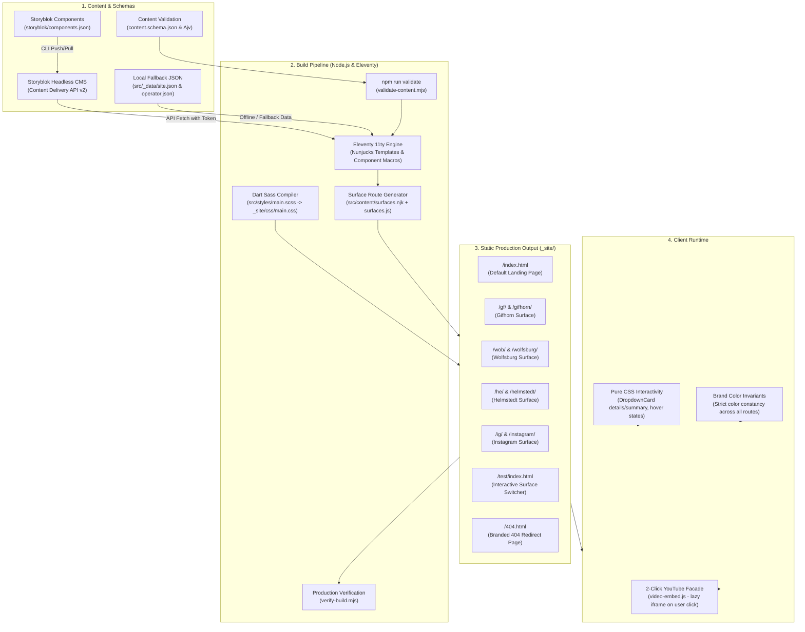

# System Architecture & Technical Specification

## 1. Executive Summary

`link-tree` is a static-first, headless CMS-driven link-in-bio platform engineered for:
1. **Sub-second static performance**: 100% pre-rendered HTML via Eleventy (11ty) v3.x and a single minified CSS stylesheet generated with Dart Sass. Zero client-side JavaScript hydration.
2. **Strict privacy by default (GDPR / DSGVO compliant)**: Zero client-side tracking, zero third-party fonts (self-hosted), zero initial third-party connections, and a privacy-first 2-click consent facade for YouTube video playback.
3. **Multi-surface targeting**: Clean, dedicated static routes (`/`, `/gf`, `/wob`, `/he`, `/ig`, `/test`) generated in a single build with canonical 301 redirects, preserving brand color constancy.
4. **Dual-tier content curation**: Granular control via `displayInDefault` / `display_in_default` (curating the default landing page independently) alongside `showOn` / `hideOn` surface filtering.
5. **Headless Storyblok integration**: Live in-browser visual editing via Storyblok's Visual Editor bridge during preview, paired with an offline JSON fallback (`src/_data/site.json`) and Storyblok CLI component synchronization.

> **RULE OF PRECEDENCE**: [`AGENTS.md`](../AGENTS.md) is the authoritative Single Source of Truth for all architectural rules, DO/DO NOT constraints, and quality standards.

---

## 2. High-Level Architecture Diagram



---

## 3. Technology Stack

| Layer | Technology | Rationale & Architectural Constraints |
|---|---|---|
| **Static Site Generator** | Eleventy (11ty) v3.x | Pre-renders all routes to clean HTML files. No client-side framework runtime (no React/Vue hydration overhead). |
| **Templating Engine** | Nunjucks | Component-based template rendering matching Storyblok blok schemas. Supports custom filters (`filterBySurface`, `resolveUrl`). |
| **Styling & Design System** | Dart Sass / SCSS | Compiles down to a single minified CSS artifact (`_site/css/main.css`). Semantic tokens in `src/styles/tokens/`. |
| **Headless CMS** | Storyblok API v2 | Visual content editing for church staff. In preview mode, Visual Editor bridge enables inline clicks; production builds remain purely static. |
| **Schema Validation** | JSON Schema Draft 2020-12 + Ajv | Strictly validates local JSON data (`src/_data/site.json`) and Storyblok payload contracts before build. |
| **Deployment Target** | Netlify / Cloudflare Pages | Portable static hosting with zero server functions required. Enforces security headers via `netlify.toml` and `_headers`. |

---

## 4. Component Hierarchy & Primitives

All 12 components are declared in [`storyblok/components.json`](../storyblok/components.json), documented in [`docs/CONTENT-MODEL.md`](./CONTENT-MODEL.md), and implemented in `src/_includes/components/`:

```
link_page (Root Page)
├── a11y_button--skip (Pre-rendered skip-to-content keyboard anchor)
├── profile_header (Logo avatar, church name, bio tagline)
├── body (Ordered list of content blocks)
│   ├── link_button (Full-width action button with optional icon)
│   ├── dropdown_card (Collapsible details/summary service times & locations)
│   │   └── dropdown_time_item (Mini cards: time badge, venue, Echo Kids badge, link)
│   ├── image_card_horizontal (16:9 featured horizontal card with title & arrow)
│   ├── image_card_vertical (3:4 portrait flyer card with title & arrow)
│   ├── video_link_card (Privacy 2-click video card with YouTube ID support)
│   ├── group_block (Container card grouping nested buttons or media cards)
│   └── section_heading (Uppercase category divider)
├── a11y_button--floating (Persistent bottom-right accessibility trigger)
├── a11y_modal (HTML5 dialog for font scaling & 21:1 high contrast modes)
└── footer_legal (Organization details, Impressum/Datenschutz links, social buttons)
    └── social_item (Circular icon buttons for Instagram, YouTube, WhatsApp, etc.)
```

---

## 5. Dual-Tier Curation & Surface Routing

### 5.1 Dual-Tier Curation Model
1. **Tier 1: Default Page Curation (`displayInDefault` / `display_in_default`)**
   - Boolean switch available on all components.
   - When `false`, the item is omitted from the main homepage (`/`), keeping the landing view focused.
2. **Tier 2: Surface Targeting (`showOn` / `hideOn`)**
   - Multi-select target array (`gifhorn`, `wolfsburg`, `helmstedt`, `instagram`).
   - Items with `displayInDefault: false` and `showOn: ["gifhorn"]` render exclusively on `/gf` and `/gifhorn`.

### 5.2 Static Surface Routes & Shortcuts

| Route Path | Canonical Surface | Purpose / Content Scope |
|---|---|---|
| `/` | `default` | Curated universal landing page; general church links and default service times. |
| `/gf/` & `/gifhorn/` | `gifhorn` | Gifhorn campus landing page (services at 10:00 & 12:00 in BSK-Saal). |
| `/wob/` & `/wolfsburg/` | `wolfsburg` | Wolfsburg campus landing page (Sunday service at 11:00). |
| `/he/` & `/helmstedt/` | `helmstedt` | Helmstedt campus landing page (Sunday service at 12:00). |
| `/ig/` & `/instagram/` | `instagram` | Instagram bio traffic landing page. |
| `/test/` | `all` | Preview-only test page with interactive toolbars; redirected to `/` in production. |
| `/404.html` | `default` | Branded 404 page featuring the Echo logo; redirects to `/`. |

*(Note: Legal requirements for Impressum and Datenschutzerklärung are served via external canonical links to `https://kirche-echo.de/impressum/` and `https://kirche-echo.de/datenschutz/` in the footer. Local routes are not served.)*

### 5.3 Brand Color Invariant
**Brand colors must never change based on URL parameters, surfaces, or sublinks.**
- All city pages (`/gf`, `/wob`, `/he`), channel pages (`/ig`), and default routes share the identical canonical brand palette (`#08415C` Dark Teal Blue, `#846B8A` Muted Lavender, `#FEFADC` Light Pastel Yellow).

---

## 6. Security, Privacy & Runtime Budget

1. **Content Security Policy (CSP)**:
   - Configured in `netlify.toml` and `_headers`.
   - Restricts scripts, frames, and connections to self, Storyblok visual editor, and `youtube-nocookie.com`.
2. **Zero-Cookie Baseline**:
   - Zero tracking cookies, zero analytics, zero external font downloads.
3. **Runtime Budget Checks (`scripts/verify-build.mjs`)**:
   - Target production JavaScript: 0 KB (excluding justified vanilla helpers).
   - Maximum production script size: < 10 KB (for `surface-switcher.js` covering campus switching, 6 brand themes, and the responsive a11y preferences modal & contrast toggler).
   - Preview visual editor bridge: < 16 KB.
   - Forbidden: Initial `<iframe>` tags, Google Fonts, unauthorized `<script>` tags, and `javascript:` URIs.

---

## 7. Build & Verification Pipeline

```bash
# 1. Validate JSON data against schema
npm run validate

# 2. Compile and minify Sass design tokens and components
npm run build:sass

# 3. Static site compilation with Eleventy
npm run build:eleventy

# 4. Strict bundle size and output file verification
node scripts/verify-build.mjs

# 5. Run automated unit & integration test suites (45+ tests)
npm test
```
