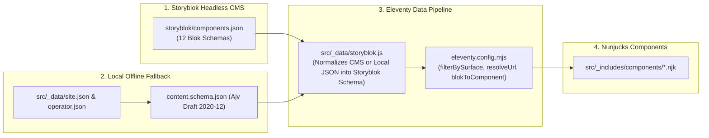

# Content Model Specification

This document specifies the authoritative production content model for the `link-tree` static site, detailing both the **Storyblok CMS Blok Schemas** (`storyblok/components.json`) and the **Local Fallback JSON Schema** (`content.schema.json`).

> **RULE OF PRECEDENCE**: [`AGENTS.md`](file:///Users/Shared/projeckt/goto/link-tree/AGENTS.md) is the authoritative Single Source of Truth for architectural rules and coding standards.

---

## 1. Dual-Model Architecture

The application operates on a unified dual-model:



When building with `STORYBLOK_TOKEN`, the Eleventy data loader (`src/_data/storyblok.js`) fetches stories directly from the Storyblok Content Delivery API v2. When offline or without a token, the local files `src/_data/site.json` and `src/_data/operator.json` are validated against `content.schema.json` and transformed into the exact same Storyblok blok schema shape.

---

## 2. Component Hierarchy & Schemas

### 2.1 Root Content Type: `link_page`

The root document containing the entire page tree:

| Field Name | Type | Required | Description & Validation |
| :--- | :--- | :--- | :--- |
| `title` | Text | Yes | Page title (e.g., `"Echo Kirche"`). |
| `theme` | Options | No | Theme mode: `light` (default), `pale`, `warm`, `soft`, `dark`, `teal`, `lavender`. |
| `surface` | Options | No | Default surface context (default: `"default"`). |
| `profile` | Blocks | Yes | Exactly 1 `profile_header` blok. |
| `body` | Blocks | Yes | Ordered array of content bloks (`link_button`, `dropdown_card`, `image_card_horizontal`, `image_card_vertical`, `video_link_card`, `group_block`, `section_heading`). |
| `footer` | Blocks | Yes | Exactly 1 `footer_legal` blok. |

---

### 2.2 Header Component: `profile_header`

Renders the church/organization logo avatar, title, and bio:

| Field Name | Type | Required | Description & Validation |
| :--- | :--- | :--- | :--- |
| `name` | Text | Yes | Church or organization name (max 120 chars). |
| `bio` | Textarea | No | Optional tagline or introduction (max 500 chars). |
| `avatar` | Asset | No | Image asset (WebP format preferred, max 400 KB). |

---

### 2.3 Action Button: `link_button`

Prominent full-width button for primary calls-to-action:

| Field Name | Type | Required | Description & Validation |
| :--- | :--- | :--- | :--- |
| `label` | Text | Yes | Button label (max 160 chars). |
| `url` | Text / Multilink | Yes | Safe destination URL (validated via `resolveUrl`). |
| `icon` | Options | No | Optional icon: `church`, `calendar`, `video`, `heart`, `users`, `location`, `music`, `newsletter`, `podcast`, `envelope`, `globe`, `logo`, `link`. |
| `display_in_default` | Boolean | No | Tier 1 curation: `true` to render on `/`, `false` to hide from `/`. Default: `true`. |
| `show_on` | Multi-select | No | Tier 2 target surfaces (`gifhorn`, `wolfsburg`, `helmstedt`, `instagram`). |
| `hide_on` | Multi-select | No | Tier 2 excluded surfaces. |

---

### 2.4 Service Times & Locations: `dropdown_card`

Collapsible accordion disclosure powered by pure CSS `<details>` and `<summary>`:

| Field Name | Type | Required | Description & Validation |
| :--- | :--- | :--- | :--- |
| `label` | Text | Yes | Summary header text (e.g., `"Gottesdienste & Zeiten"`). |
| `icon` | Options | No | Icon displayed next to label (default: `"church"`). |
| `description` | Text | No | Intro text revealed when expanded (max 300 chars). |
| `layout` | Options | No | Layout mode: `"columns"` (responsive 3-column grid) or `"list"`. Default: `"columns"`. |
| `locations` | Multi-select | No | Active location tags (`["gifhorn", "wolfsburg", "helmstedt"]`). |
| `times` / `columns` | Blocks | No | Array of `dropdown_time_item` bloks. |
| `url` | Text / Multilink | No | Optional link for bottom action button. |
| `action_label` | Text | No | Label for action link (default: `"Standort & Infos →"`). |
| `display_in_default` | Boolean | No | Tier 1 curation flag. Default: `true`. |
| `show_on` / `hide_on` | Multi-select | No | Tier 2 surface filters. |

---

### 2.5 Service Mini Card: `dropdown_time_item`

Individual service schedule card nested inside `dropdown_card`:

| Field Name | Type | Required | Description & Validation |
| :--- | :--- | :--- | :--- |
| `title` | Text | Yes | Location/service title (e.g., `"Gifhorn"`). |
| `time` | Text | Yes | Service time badge (e.g., `"10:00 & 12:00 Uhr"`). |
| `location` | Text | No | Venue or address (e.g., `"BSK-Saal"`). |
| `details` | Text | No | Additional notes (e.g., `"Inklusive Kaffee & Snacks"`). |
| `has_kids` | Boolean | No | Echo Kids indicator switch. Default: `false`. |
| `kids_label` | Text | No | Kids badge text (default: `"Echo Kids verfügbar"`). |
| `url` | Text / Multilink | No | Target URL for campus details. |
| `action_label` | Text | No | Link label (default: `"Standort & Infos →"`). |
| `display_in_default` | Boolean | No | Tier 1 curation flag. Default: `true`. |
| `show_on` | Multi-select | No | Target surface (e.g., `["gifhorn"]`). |

---

### 2.6 Horizontal Media Card: `image_card_horizontal`

16:9 aspect-ratio visual banner card:

| Field Name | Type | Required | Description & Validation |
| :--- | :--- | :--- | :--- |
| `label` | Text | No | Optional card title (max 160 chars). When omitted, renders as an image-only link banner. |
| `url` | Text / Multilink | Yes | Safe destination URL. |
| `image` | Asset / String Link | Yes | Image asset (WebP, 16:9 ratio, max 1900px, max 400 KB) or direct link/path string (e.g., `/assets/images/...` or `https://...`). |
| `display_in_default` | Boolean | No | Tier 1 curation flag. Default: `true`. |
| `show_on` / `hide_on` | Multi-select | No | Tier 2 surface filters. |

---

### 2.7 Vertical Media Card: `image_card_vertical`

3:4 aspect-ratio portrait flyer card:

| Field Name | Type | Required | Description & Validation |
| :--- | :--- | :--- | :--- |
| `label` | Text | No | Optional card title (max 160 chars). When omitted, renders as an image-only link banner. |
| `url` | Text / Multilink | Yes | Safe destination URL. |
| `image` | Asset / String Link | Yes | Image asset (WebP, 3:4 ratio, max 1400px, max 400 KB) or direct link/path string (e.g., `/assets/images/...` or `https://...`). |
| `display_in_default` | Boolean | No | Tier 1 curation flag. Default: `true`. |
| `show_on` / `hide_on` | Multi-select | No | Tier 2 surface filters. |

---

### 2.8 Privacy Video Card: `video_link_card`

Privacy 2-click consent YouTube card:

| Field Name | Type | Required | Description & Validation |
| :--- | :--- | :--- | :--- |
| `label` | Text | Yes | Video title (max 160 chars). |
| `provider` | Options | No | Video provider: `"youtube"` (default), `"vimeo"`, `"other"`. |
| `youtube_video_id` | Text | No* | 11-character YouTube video ID (required if provider is YouTube). |
| `youtube_content_type` | Options | No | `"video"` (standard) or `"live"` (livestream). Default: `"video"`. |
| `url` | Text / Multilink | No | Full URL (used as fallback or for non-YouTube providers). |
| `image` | Asset | No | Custom thumbnail image (local WebP). |
| `display_in_default` | Boolean | No | Tier 1 curation flag. Default: `true`. |
| `show_on` / `hide_on` | Multi-select | No | Tier 2 surface filters. |

---

### 2.9 Container Box: `group_block`

Groups multiple buttons or cards within a styled container panel:

| Field Name | Type | Required | Description & Validation |
| :--- | :--- | :--- | :--- |
| `title` | Text | No | Optional group header title. |
| `description` | Text | No | Optional group description. |
| `variant` | Options | No | Visual style: `"card"`, `"soft"`, `"outline"`, `"transparent"`. Default: `"card"`. |
| `items` | Blocks | Yes | Nested bloks (`link_button`, `dropdown_card`, `image_card_horizontal`, etc.). |
| `display_in_default` | Boolean | No | Tier 1 curation flag. Default: `true`. |
| `show_on` / `hide_on` | Multi-select | No | Tier 2 surface filters. |

---

### 2.10 Section Divider: `section_heading`

Visual uppercase divider for categorizing link groups:

| Field Name | Type | Required | Description & Validation |
| :--- | :--- | :--- | :--- |
| `title` | Text | Yes | Category header text (max 80 chars). |
| `display_in_default` | Boolean | No | Tier 1 curation flag. Default: `true`. |

---

### 2.11 Legal Footer: `footer_legal`

Contains church legal details, mandatory Impressum/Datenschutz links, and social items:

| Field Name | Type | Required | Description & Validation |
| :--- | :--- | :--- | :--- |
| `organization_name` | Text | Yes | Legal organization name (e.g., `"Echo Kirche e.V."`). |
| `street` | Text | Yes | Street address. |
| `city` | Text | Yes | Postal code and city. |
| `email` | Text | Yes | Contact email address. |
| `impressum_url` | Text | Yes | Link to Impressum (default: `"https://kirche-echo.de/impressum/"`). |
| `datenschutz_url` | Text | Yes | Link to Datenschutz (default: `"https://kirche-echo.de/datenschutz/"`). |
| `copyright_year` | Number | No | Copyright year (default: current year). |
| `socials` | Blocks | No | Array of `social_item` bloks. |
| `display_in_default` | Boolean | No | Tier 1 curation flag. Default: `true`. |
| `show_on` | Multi-select | No | Campus filter for location-specific footers. |

---

### 2.12 Social Item: `social_item`

Circular social media icon button:

| Field Name | Type | Required | Description & Validation |
| :--- | :--- | :--- | :--- |
| `platform` | Options | Yes | Platform: `instagram`, `youtube`, `whatsapp`, `spotify`, `email`, `website`, `facebook`, `tiktok`, `linkedin`. |
| `url` | Text / Multilink | Yes | Safe profile URL. |
| `label` | Text | No | Accessible ARIA label. |

---

## 3. Graceful Nullability & Fallback Rules

Components MUST NOT crash when optional CMS fields are omitted. The following fallback behaviors are enforced in Nunjucks templates:

1. **Missing `bio`**: `ProfileHeader.njk` skips the bio `<p>` tag entirely.
2. **Missing `avatar`**: Renders the text title without an avatar container.
3. **Missing `icon`**: `LinkButton.njk` renders text-only button without an empty `<span>`.
4. **Missing `image`**: Media cards fallback to a styled neutral placeholder or title-only card.
5. **Storyblok Multilink vs Plain URL**: The `resolveUrl` filter handles both plain string URLs (`"https://kirche-echo.de"`) and Storyblok multilink objects (`{ linktype: "url", url: "https://..." }`), returning a safe string.
6. **Dangerous Protocols**: `resolveUrl` blocks `javascript:` and `data:` protocols, returning empty string `""` to prevent XSS attacks.
7. **Direct Image Links & Optional Labels in Media Cards**: Image cards (`image_card_horizontal`, `image_card_vertical`) accept both structured image objects (`{ src, alt, width, height }` or `{ filename }`) and direct string URLs/paths (a link as image). If `label` is omitted, the card renders as a pure image link banner without an empty bottom title bar.

---

## 4. Dual-Tier Curation Logic

Surface filtering is executed by the `filterBySurface` filter in `eleventy.config.mjs`:

```
1. If surface === 'all':
   Show all items (used exclusively for /test preview toolbar).

2. If surface === 'default' (Root landing page /):
   a. Check displayInDefault (or display_in_default):
      - If explicitly false -> HIDE.
      - If true or undefined -> proceed to step b.
   b. Check showOn (or show_on):
      - If showOn is non-empty and does NOT include 'default' -> HIDE.
   c. Check hideOn (or hide_on):
      - If hideOn contains 'default' -> HIDE.
   d. Otherwise -> SHOW.

3. If surface === <campus> (e.g., 'gifhorn', 'wolfsburg', 'helmstedt', 'instagram'):
   a. Check showOn (or show_on):
      - If showOn is non-empty and does NOT include <campus> -> HIDE.
   b. Check hideOn (or hide_on):
      - If hideOn contains <campus> -> HIDE.
   c. Otherwise -> SHOW.
```
