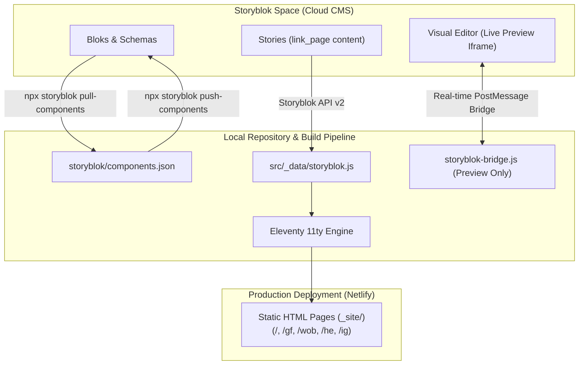

# Storyblok Headless CMS Integration & Component Guide
# Storyblok CMS Integration & Komponenten-Anleitung

> **RULE OF PRECEDENCE**: [`AGENTS.md`](../AGENTS.md) is the authoritative Single Source of Truth for architectural rules, DO/DO NOT constraints, and quality standards.

This guide explains how to use Storyblok with this link-in-bio website. It contains complete instructions in **Simple English** and **Einfaches Deutsch** on how to create, configure, and fill each component in Storyblok.

Diese Anleitung erklärt die Pflege der Link-in-Bio-Website mit Storyblok. Sie enthält Schritt-für-Schritt-Anleitungen auf **Einfachem Deutsch** und **Simple English**, wie jede Komponente erstellt und ausgefüllt wird.

---

## 1. Architecture & Privacy Guarantees / Architektur & Datenschutz

- **Static-first**: The website builds into pure, lightning-fast static HTML.
- **Privacy-first**: Zero tracking cookies, zero external fonts (all fonts are local), and zero initial third-party connections.
- **Visual Editor**: The Storyblok live preview bridge only loads when an editor is actively previewing inside the Storyblok Visual Editor (`?_storyblok=...`). Visitors never load any Storyblok scripts.
- **Official Echo Kirche Styleguide**:
  - **Colors**: Primary Teal (`#08415C`), Secondary Lavender (`#846B8A`), Background Pastel Yellow (`#FEFADC`).
  - **Typography**: `Clash Display` (600 Semibold) for headings & sub-brand wordmarks; `Inter` (400 Regular) for body/UI; optional digital accents `Perandory Condensed` & `Sloop Script Pro`.
  - **Sub-Brand Logo Rule**: When displaying the sub-brand text logo, **echo** is set in `Clash Display Semibold` (`600`) and **kids** is set in `Clash Display Regular` (`400`).
  - **Logo Clear Space (*Schutzzone*)**: Maintained equal to the width/height of lowercase "e" from *echo* wordmark on all four sides. No text, buttons, or graphics may enter this zone. Never stretch, compress, rotate, or distort the logo.
  - **Media Budget & Subject Matter**: Upload `.webp` format only, **max 400KB** per image, max width **1900px** for heroes and **1400px** for standard cards (`16:9`, `3:2`, `4:3`, `3:4` aspect ratios). Subject matter: authentic photos of people, community, faces, and visible emotions.
  - **Brand Color Constancy**: Theme colors remain consistent across all pages and surfaces. URL parameters filter content without altering brand colors.



---

## 2. Component Synchronization / Komponenten synchronisieren

Component schemas are declared in [`storyblok/components.json`](../storyblok/components.json) for direct synchronization via the Storyblok CLI:

| Blok Component | Type | Description |
|---|---|---|
| `link_page` | Content Type | Root content type holding page title, theme (`light`, `pale`, `soft`, `dark`, `teal`, `lavender`), surface, `profile` blok, `body` bloks, and `footer` blok. |
| `profile_header` | Nestable Blok | Organization name, biography, and vector/raster avatar asset. |
| `group_block` | Nestable Blok | Container block with optional title, description, and style variant (`card`, `soft`, `outline`, `transparent`) that groups nested buttons, cards, and videos inside. |
| `link_button` | Nestable Blok | Label, URL, optional icon selection (supports any Font Awesome icon like `fa-cross`, `fa-star`, `ticket`, `church`, or raw SVG), and surface filtering rules (`show_on`, `hide_on`). |
| `dropdown_card` | Nestable Blok | Collapsible service times and locations card with responsive 3-column auto-fit grid and pure CSS details/summary state. |
| `dropdown_time_item` | Nestable Blok | Individual service column/card with title, time badge, location, details, Echo Kids badge, and link. |
| `donation_card` | Nestable Blok | Collapsible donation drawer and dropdown button with PayPal, online banking buttons, bank transfer details (IBAN/BIC), and one-click copy button. |
| `accordion_buttons` | Nestable Blok | Multi-row collapsible accordion drawer with 1 full button, 2 half buttons, or 1 expanded button (up to 5 fields + copy button) per row, across any number of rows. |
| `image_card_horizontal` | Nestable Blok | 16:9 featured horizontal media card with title, URL, image asset, and bottom-right arrow indicator badge (`->`). |
| `image_card_vertical` | Nestable Blok | 3:4 portrait orientation media card with title, URL, image asset, and bottom-right arrow indicator badge (`->`). |
| `video_link_card` | Nestable Blok | Privacy-first video card. YouTube uses a `youtube_video_id` plus optional `youtube_content_type` (`video` or `live`); non-YouTube providers may use `url`. The YouTube player loads only after an explicit click using YouTube Privacy-Enhanced Mode. |
| `section_heading` | Nestable Blok | Section title divider. |
| `footer_legal` | Nestable Blok | Organization contact info (`organization_name`, `street`, `city`, `email`), legal URLs (`impressum_url`, `datenschutz_url`), copyright year, and `socials` list. |
| `social_item` | Nestable Blok | Circular social button with platform (`instagram`, `whatsapp`, `youtube`, `spotify`, `email`, `website`, `facebook`, `tiktok`, `linkedin`), URL, and label. |

---

## 3. Synchronizing Components with Storyblok

To push the components schema to your Storyblok Space:

```bash
# 1. Login to Storyblok
npx storyblok login

# 2. Push component schemas to your space
npx storyblok push-components storyblok/components.json --space <YOUR_SPACE_ID>

# 3. Pull latest changes if modified in Storyblok web UI
npx storyblok pull-components --space <YOUR_SPACE_ID>
```

---

## 3. Editor Guidelines in Simple English

Here is how to create and fill every component in Storyblok.

---

### Component: `link_page` (Page Root)
The main entry point for the entire page.

- **How to create**: Create a new Story in Storyblok and select `link_page` as the Content Type.
- **Fields to fill**:
  - `title` (Text): The page title (e.g., `Echo Kirche`).
  - `theme` (Dropdown): Choose color theme (`light`, `pale`, `soft`, `dark`, `teal`, `lavender`).
  - `surface` (Dropdown): Default surface target (usually `default`).
  - `profile` (Bloks): Add exactly one `profile_header` block here.
  - `body` (Bloks): Add your main content blocks here (buttons, cards, groups, headings).
  - `footer` (Bloks): Add exactly one `footer_legal` block here.

---

### Component: `profile_header` (Header & Avatar)
Shows the church/organization logo or avatar, name, and optional short bio.

- **How to create**: Add inside the `profile` field of `link_page`.
- **Fields to fill**:
  - `name` (Text, Required): Name displayed under the logo (e.g., `Echo Kirche`).
  - `bio` (Textarea, Optional): Short bio or tagline (e.g., `Willkommen bei Echo!`). Leave empty if you only want the title.
  - `avatar` (Asset, Optional): Upload your logo or photo (SVG, WebP, or PNG).

---

### Component: `link_button` (Standard Action Button)
A prominent full-width button that links to an external page or action.

- **How to create**: Add inside `body` or inside a `group_block`.
- **Fields to fill**:
  - `label` (Text, Required): Button text (e.g., `Spenden & Unterstützen` or `Website besuchen`).
  - `url` (Text, Required): Target web address (e.g., `https://kirche-echo.de/spenden`).
  - `icon` (Text, Optional): Enter any Font Awesome icon name (e.g., `church`, `calendar`, `video`, `heart`, `users`, `location`, `music`, `newsletter`, `podcast`, `envelope`, `globe`, `logo`, `link`, `fa-cross`, `fa-star`, `fa-phone`, `ticket`, `mug-hot`, `bible`, or any `fa-*` icon), raw SVG markup, or `<i>` class tag. Leave blank for no icon.
  - `display_in_default` (Boolean, Default: `true`): **Display on Default Page Switch**. Set to `true` to show on the default landing page (`/`). Set to `false` to hide on default and use exclusively for custom surfaces (`gifhorn`, `wolfsburg`, `helmstedt`, `instagram`).
  - `show_on` (Multi-select, Optional): Select specific surfaces if this button should only show there (e.g., choose `gifhorn` so it only shows on `/gf` and `/gifhorn`).
  - `hide_on` (Multi-select, Optional): Select surfaces where this button should be hidden.

---

### Component: `dropdown_card` (Collapsible Service Times Dropdown Button & Card)
An interactive disclosure card showing church service times and locations. It is triggered by a prominent, full-width **Dropdown Button** that smoothly expands on click or keyboard press to reveal a **responsive 3-column auto-fit card grid by default** (Gifhorn, Wolfsburg, Helmstedt) or a single-column vertical list.

#### Dropdown Button Trigger Anatomy
- **Button Styling (`<summary class="dropdown-card__summary link-button">`)**:
  - Functions as a clickable button styled identically to a standard `.link-button` (pill shape, brand background `--color-action-bg`, contrasting text `--color-action-text`, focus ring, and active hover elevation).
- **Leading Icon (`.link-button__icon`)**:
  - Displays a visual icon on the left (default is `church`).
  - Supports any Font Awesome icon name (e.g. `church`, `calendar`, `clock`, `map-pin`, `users`, or any `fa-*` icon), raw inline `<svg>` markup, or `<i>` class tag rendered via the self-hosted `FaIcon.njk` component.
- **Centered Label (`.link-button__label`)**:
  - Displays the prominent headline text centered on the button (e.g. `Gottesdienste & Zeiten`).
- **Animated Chevron Indicator (`.dropdown-card__chevron`)**:
  - A right-aligned chevron arrow (`fa-chevron-down`) that smoothly rotates 180 degrees via pure CSS when the card expands (`[open] .dropdown-card__chevron svg { transform: rotate(180deg); }`).
- **Zero-JavaScript Pure CSS Disclosure**:
  - Functions with 100% native HTML5 `<details class="dropdown-card">` and `<summary>` (zero client JavaScript, zero cookies, 100% DSGVO/GDPR compliant).
- **Keyboard Navigation & Accessibility (a11y)**:
  - Operable via keyboard: press `Tab` to navigate to the button, and `Enter` or `Space` to toggle open and closed.
  - Native browser semantics handle announcement of expanded/collapsed states for screen readers.
  - Fully compatible with high-contrast modes (WCAG AAA 21:1) and typography scale preferences (100%, 115%, 130%) from the accessibility drawer.

- **How to create**: Add inside `body` or inside a `group_block`.
- **Fields to fill**:
  - `label` (Text, Required): Header text of the button (e.g., `Gottesdienste & Zeiten`).
  - `display_in_default` (Boolean, Default: `true`): **Display on Default Page Switch**. Set to `true` to show on default page (`/`). Set to `false` for campus-specific schedule views.
  - `layout` (Dropdown, Default: `columns`): Choose `columns` (responsive 3-column card grid) or `list` (classic single-column list).
  - `locations` (Multi-select, Default: `["gifhorn", "wolfsburg", "helmstedt"]`): Select active locations/channels (`gifhorn`, `wolfsburg`, `helmstedt`, `instagram`).
  - `icon` (Text, Optional): Leading icon name (default: `church`, or any `fa-*` icon, raw SVG, or `<i>` tag).
  - `description` (Text, Optional): Introductory text beneath the button when opened (e.g., `Feiere mit uns vor Ort in Gifhorn, Wolfsburg und Helmstedt oder online im Livestream:`).
  - `times` / `columns` (Bloks, Optional): Add one or more `dropdown_time_item` blocks for each column or time slot.
  - `url` (Text, Optional): Link for bottom action button (e.g., `https://kirche-echo.de`).
  - `action_label` (Text, Optional): Overwrite the footer action link label (Default: `Alle Standorte & Livestream ansehen →`).
  - `show_on` / `hide_on` (Multi-select, Optional): Surface filtering rules.

---

### Component: `dropdown_time_item` (Location Column / Service Time Mini Card)
A single location column card or time slot entry inside a `dropdown_card`. Every single element (title, time, location, details, kids badge, url, action label) is completely editable and overwritable.

- **How to create**: Add inside the `times` or `columns` field of `dropdown_card`.
- **Fields to fill**:
  - `title` (Text, Required): Name of the location or service (e.g., `Gifhorn (10:00)`, `Gifhorn (12:00)`, `Wolfsburg`, `Helmstedt`).
  - `time` (Text, Required): Badge time text (e.g., `10:00 Uhr`, `12:00 Uhr`, `11:00 Uhr`).
  - `location` (Text, Optional): Venue or campus address (e.g., `BSK-Saal, Schützenplatz 3`, `Standort Wolfsburg`).
  - `details` (Textarea, Optional): Description or info (e.g., `Unsere Gottesdienste finden jeden Sonntag um 10:00 und 12:00 Uhr nebenan im BSK-Saal, Schützenplatz 3 statt.`).
  - `display_in_default` (Boolean, Default: `true`): **Display on Default Page Switch**. Set to `true` to show this card on the default page. Set to `false` to show it only on custom location pages.
  - `has_kids` (Boolean, Optional, Default: `true`): Toggle to show an Echo Kids badge indicating children's church is available.
  - `kids_label` (Text, Optional, Default: `Echo Kids verfügbar`): Customizable label text next to the kids badge (automatically adapts to service times like `Echo Kids Check-in: 9:30 Uhr` or custom).
  - `url` (Text, Optional): Specific location destination link (e.g., `https://kirche-echo.de/gifhorn`).
  - `action_label` (Text, Optional): Column link text (e.g., `Standort Gifhorn →`).
  - `show_on` / `hide_on` (Multi-select, Optional): Control which surfaces this location column appears on (e.g., `["default", "gifhorn"]`).

---

### Component: `donation_card` (Interactive Expandable Action Card / Donation Drawer)
> [!NOTE]
> **Superseded by `accordion_buttons`**: In production, use `accordion_buttons` (Dropdown Accordion). It provides a single unified component capable of handling PayPal, Online-Banking, expanded IBAN details, and event VIP-codes simultaneously across multiple flexible rows. `donation_card` remains supported for backward compatibility.

A pure-CSS collapsible interactive drawer with a dual-row interactive layout. While optimized out-of-the-box for church donations and bank transfers, it is **100% generalized to display any custom interactive card, event registration, Wi-Fi credentials, voucher code, or action flow** with the exact same visual styling and behavior:
- **Trigger Dropdown Button**: Styled identically to `.link-button` with custom icon, label, and animated rotating chevron.
- **Row 1 (Actions)**: Renders either a **single whole full-width button** or **two responsive side-by-side buttons** with custom labels, icons, URLs, and color variants (`primary`, `secondary`, `paypal`, `iban`).
- **Row 2 (Information & Copy Card)**: Monospace code styling and custom key-value details with an accessible copy-to-clipboard button (`data-copy-text` / `data-copy-iban`) providing instant live feedback (`Kopiert! ✓`).

#### Dropdown Button Trigger Anatomy
- **Button Styling (`<summary class="donation-card__summary link-button">`)**:
  - Styled identically to a `.link-button` with full width, rounded pill shape, and smooth hover and focus transitions.
- **Leading Icon (`.link-button__icon`)**:
  - Default: `heart`. Supports any Font Awesome icon name (e.g. `heart`, `ticket`, `wifi`, `key`, `gift`, `church`, or any `fa-*` icon), raw inline SVG, or `<i>` class tag.
- **Centered Label (`.link-button__label`)**:
  - Default: `Spenden & Unterstützen`. Fully editable for any use case (e.g. `Anmeldung & Tickets`, `WLAN-Zugang`).
- **Animated Chevron Indicator (`.donation-card__chevron`)**:
  - Right-aligned chevron down icon (`fa-chevron-down`) that rotates 180° when expanded.
- **Zero-JavaScript Pure CSS Interactivity**:
  - Built with native HTML5 `<details class="donation-card">` and `<summary>`. No client-side framework scripts required.
- **Expanded Drawer Content**:
  - `description`: Explanatory message, donation appeal, or instructions for the user.
  - **Row 1 (Quick Action Buttons)**:
    - **Single Full-Width Button**: When only `button_1_*` (or `paypal_*`) is set, stretches across the full width.
    - **Dual Buttons**: When `button_1_*` and `button_2_*` (or PayPal and Banking) are set, forms a responsive 2-column button row.
  - **Row 2 (Information & Copy Card)**:
    - Structured fields for `card_title` (or `iban_title`), `card_icon`, arbitrary details list or bank transfer items.
    - Values with `isCode: true` (or `iban`) are rendered in monospace `<code>` font.
  - **Interactive Copy Button**: Built-in accessible button (`copy_label` / `copy_text`) wired to `clipboard-copy.js` that copies arbitrary text (`copy_value` or `iban`) to the clipboard with instant visual feedback (`Kopiert! ✓`).

- **How to create**: Add inside `body` or inside a `group_block`.
- **Fields to fill**:
  - `label` (Text, Required): Header text on the dropdown button (default: `Spenden & Unterstützen`).
  - `icon` (Text, Optional): Leading icon name (default: `heart`, or any Font Awesome icon).
  - `description` (Text, Optional): Introductory text displayed inside the drawer.
  - `display_in_default` (Boolean, Default: `true`): Show on default landing page (`/`).
  - `button_1_label` (Text, Optional): Text on Button 1 (e.g., `Tickets buchen`).
  - `button_1_url` (Text / Multilink, Optional): Target URL for Button 1.
  - `button_1_icon` (Text, Optional): Font Awesome icon for Button 1 (e.g., `ticket`).
  - `button_1_variant` (Dropdown, Optional): `primary` (default), `secondary`, `paypal`, or `iban`.
  - `button_2_label` (Text, Optional): Text on secondary button (Row 1 splits into 2 buttons when set).
  - `button_2_url` (Text / Multilink, Optional): Target URL for Button 2.
  - `button_2_icon` (Text, Optional): Font Awesome icon for Button 2.
  - `button_2_variant` (Dropdown, Optional): `secondary` (default), `primary`, `paypal`, or `iban`.
  - `card_title` (Text, Optional): Title of Row 2 details card (e.g. `Zugangsdaten`, `Bankverbindung`). Overrides `iban_title`.
  - `card_icon` (Text, Optional): Icon next to card title in Row 2 (e.g., `wifi`, `key`).
  - `copy_value` (Text, Optional): The text string to copy to clipboard. Overrides `iban`.
  - `copy_label` (Text, Optional): Text on the copy button (default: `IBAN kopieren` or `Kopieren`).
  - `paypal_label` (Text, Optional): Preset text on PayPal button (default: `Mit PayPal spenden`).
  - `paypal_url` (Text / Multilink, Optional): Direct PayPal link (default: `https://paypal.me/echokirche`).
  - `iban_link_label` (Text, Optional): Preset text on banking button (default: `Online-Banking öffnen`).
  - `iban_link_url` (Text / Multilink, Optional): Preset giving page link (default: `https://kirche-echo.de/spenden`).
  - `iban_title` (Text, Optional): Preset title above bank transfer card (default: `Per Banküberweisung (IBAN)`).
  - `account_name` (Text, Optional): Official account holder name (default: `Echo Kirche e.V.`).
  - `iban` (Text, Optional): IBAN string (default: `DE12 3456 7890 1234 5678 90`).
  - `bic` (Text, Optional): Bank BIC/SWIFT code (default: `PBNKDEFF`).
  - `bank_name` (Text, Optional): Name of the bank (default: `Postbank`).
  - `reference` (Text, Optional): Verwendungszweck / payment reference (default: `Spende Echo Kirche`).
  - `show_on` / `hide_on` | Multi-select | No | Surface filtering rules.

---

### Component: `accordion_buttons` / `dropdown_accordion` (Multi-Row Accordion Drawer)
A pure-CSS collapsible interactive accordion drawer designed for versatile button layouts (aliased as `dropdown_accordion`, `dropdown-accordion`, and `accordion_buttons`). Allows editors to create **any number of rows**, where each row can independently be configured as:
1. **1 Full Button (`full`)**: 100% wide prominent action button rendered with standard `link_button` styling (icon, label, accessible focus).
2. **2 Half Buttons (`half`)**: Two side-by-side action buttons (50% each) that adapt responsively, both rendered with standard `link_button` styling.
3. **1 Expanded Button / Card (`expanded`)**: An expandable details card with bank transfer information (Kontoinhaber, IBAN, BIC, Bank, Verwendungszweck) and a copy-to-clipboard button using the `donation-card__copy-btn` style.

- **How to create**: Add inside `body` or inside a `group_block`.
- **Fields to fill**:
  - `label` (Text, Required): Summary text on the expandable dropdown button (e.g. `Spenden, Aktionen & Details`).
  - `icon` (Text, Optional): Leading icon name (default: `layer-group`, or any Font Awesome icon/SVG).
  - `description` (Text, Optional): Introductory text displayed inside the drawer.
  - `display_in_default` (Boolean, Default: `true`): Show on default landing page (`/`).
  - `rows` (Blocks, Required): Add rows of type `full`, `half`, or `expanded`.
  - `show_on` / `hide_on` (Multi-select, Optional): Surface filtering rules.

---

### Component: `image_card_horizontal` (Featured Project 16:9)
A landscape media card with a 16:9 preview image, title, and interactive arrow button. Great for sermon series, conferences, or featured campaigns. Can also be used as a pure image link banner by omitting the label.

- **How to create**: Add inside `body` or inside a `group_block`.
- **Fields to fill**:
  - `label` (Text, Optional): Headline under the image (e.g., `Neue Predigtreihe: Hoffnung`). Leave empty for a pure image link banner.
  - `url` (Text, Required): Target link.
  - `image` (Asset, Optional): Storyblok image (16:9, recommended size: `1200x675` or `1280x720` px). **Takes precedence** over `image_url` if both are filled.
  - `image_url` (Text, Optional): Fallback direct image link URL or local path (e.g., `https://...` or `/assets/images/...`). Used when no Storyblok `image` is set.
  - `display_in_default` (Boolean, Default: `true`): Set to `true` to display on the default page (`/`). Set to `false` to hide on default and use only on custom surfaces.
  - `show_on` / `hide_on` (Multi-select, Optional): Surface filtering.

---

### Component: `image_card_vertical` (Portrait Flyer 3:4)
A portrait media card with a 3:4 image ratio. Great for event flyers and speaker announcements. Can also be used as a pure image link banner by omitting the label.

- **How to create**: Add inside `body` or inside a `group_block`.
- **Fields to fill**:
  - `label` (Text, Optional): Title text under the image. Leave empty for a pure image link banner.
  - `url` (Text, Required): Destination web address.
  - `image` (Asset, Optional): Storyblok portrait image (3:4, recommended: `900x1200` px). **Takes precedence** over `image_url` if both are filled.
  - `image_url` (Text, Optional): Fallback direct image link URL or local path (e.g., `https://...` or `/assets/images/...`). Used when no Storyblok `image` is set.
  - `display_in_default` (Boolean, Default: `true`): Set to `true` to display on the default page (`/`). Set to `false` to hide on default and use only on custom surfaces.
  - `show_on` / `hide_on` (Multi-select, Optional): Surface filtering.

---

### Component: `video_link_card` (Privacy 2-Click Video Card)
Displays a video thumbnail with a play button. When the user clicks play, it embeds the YouTube video on demand without any prior tracking.

- **How to create**: Add inside `body` or inside a `group_block`.
- **Fields to fill**:
  - `label` (Text, Required): Video title (e.g., `Letzter Gottesdienst im Livestream`).
  - `provider` (Dropdown): Choose `youtube` or `other`.
  - `youtube_video_id` (Text): For YouTube, enter only the Video ID (e.g. `NsZVWivPeHk` or `M7lc1UVf-VE`). Also works with full YouTube URLs (the system extracts the ID).
  - `youtube_content_type` (Dropdown): Choose `video` (normal video) or `live` (live or scheduled livestream).
  - `url` (Text): Only for non-YouTube providers. Leave empty when provider is YouTube.
  - `image` (Asset, Required): Local video preview thumbnail (16:9 ratio, e.g. `1280x720` px).
  - `display_in_default` (Boolean, Default: `true`): Set to `true` to display on the default page (`/`). Set to `false` to hide on default and use only on custom surfaces.
  - `show_on` / `hide_on` (Multi-select, Optional): Surface filtering.

---

### Component: `group_block` (Container / Section Box)
Groups multiple related buttons or cards together in a container box.

- **How to create**: Add inside `body`.
- **Fields to fill**:
  - `title` (Text, Optional): Header title of the section (e.g., `Unsere Standorte`).
  - `description` (Text, Optional): Subtitle or explanation text.
  - `variant` (Dropdown):
    - `card`: Solid card box with soft border and shadow (default).
    - `soft`: Tinted subtle background.
    - `outline`: Subtle dashed border.
    - `transparent`: Seamless list without border.
  - `items` (Bloks): Add nested `link_button`, `dropdown_card`, `image_card_*`, or `video_link_card` items.
  - `display_in_default` (Boolean, Default: `true`): Set to `true` to show on default page (`/`). Set to `false` to show only on custom surfaces.
  - `show_on` / `hide_on` (Multi-select, Optional): Filter the entire group for specific surfaces.

---

### Component: `section_heading` (Category Divider)
A simple uppercase divider heading to separate content sections.

- **How to create**: Add inside `body` or inside a `group_block`.
- **Fields to fill**:
  - `title` (Text, Required): Section title (e.g., `Medien & Musik` or `Gemeindeleben`).
  - `display_in_default` (Boolean, Default: `true`): Set to `true` to show on default page (`/`). Set to `false` to show only on custom surfaces.

---

### Component: `footer_legal` (Footer & Social Links)
The legal notice, organization address, and social media icons at the bottom of the page.

- **How to create**: Add inside the `footer` field of `link_page`.
- **Fields to fill**:
  - `organization_name` (Text): Name of legal entity (`Echo Kirche KdöR`).
  - `street` (Text): Street address (default: `Schützenplatz 1`).
  - `city` (Text): Zip code and city (default: `38518 Gifhorn`).
  - `email` (Text): Contact email address.
  - `mailto` (Text, Optional): Custom mailto URI with subject (e.g., `mailto:david.loewens@kib-gifhorn.de?subject=Kontakt%20EchoHelmstedt`).
  - `impressum_url` (Text): Link to Impressum (e.g., `https://kirche-echo.de/impressum/`).
  - `datenschutz_url` (Text): Link to Privacy Policy (e.g., `https://kirche-echo.de/datenschutz/`).
  - `copyright_year` (Text): Year (e.g., `2026`).
  - `socials` (Bloks): Add circular social media buttons (`social_item`).
  - `show_on` (Multi-Options): Select which campus surfaces display this footer (`default`, `gifhorn`, `wolfsburg`, `helmstedt`, `instagram`).
  - `display_in_default` (Boolean): Check to show this footer on the main/default landing page.

---

### Component: `social_item` (Social Media Button)
A circular icon button linking to a social media profile.

- **How to create**: Add inside the `socials` field of `footer_legal`.
- **Fields to fill**:
  - `platform` (Dropdown, Required): Choose platform (`instagram`, `whatsapp`, `youtube`, `spotify`, `email`, `website`, `facebook`, `tiktok`, `linkedin`).
  - `url` (Text, Required): Link to profile or channel.
  - `label` (Text, Optional): Accessibility label for screen readers (e.g., `Instagram`, `WhatsApp`).

---

## 4. Richtlinien auf Einfachem Deutsch (German Guide)

Hier erfährst du einfach und verständlich, wie du die einzelnen Komponenten in Storyblok anlegst und ausfüllst.

---

### Komponente: `link_page` (Die Hauptseite)
Das ist die oberste Seite für deinen gesamten Linkbaum.

- **So erstellst du sie**: Erstelle eine neue Story in Storyblok und wähle als Content Type `link_page`.
- **Felder zum Ausfüllen**:
  - `title` (Text): Der Seitentitel im Browser (z. B. `Echo Kirche`).
  - `theme` (Auswahl): Wähle ein Farbschema (`light`, `pale`, `soft`, `dark`, `teal`, `lavender`).
  - `surface` (Auswahl): Standard-Kanal (normalerweise `default`).
  - `profile` (Blöcke): Füge hier genau einen `profile_header` ein.
  - `body` (Blöcke): Hier kommen deine Inhalte rein (Buttons, Karten, Gruppen).
  - `footer` (Blöcke): Füge hier genau einen `footer_legal` ein.

---

### Komponente: `profile_header` (Profilkopf & Logo)
Zeigt das Logo oder Bild, den Namen der Kirche und eine kurze Beschreibung oben auf der Seite.

- **Wo einfügen**: In das Feld `profile` der `link_page`.
- **Felder zum Ausfüllen**:
  - `name` (Text, Pflicht): Name unter dem Logo (z. B. `Echo Kirche`).
  - `bio` (Textfeld, Optional): Kurzer Text oder Motto. Wenn du keinen Text möchtest, lass das Feld einfach leer.
  - `avatar` (Datei, Optional): Lade dein Logo oder Profilbild hoch (SVG, WebP oder PNG).

---

### Komponente: `link_button` (Standard-Link-Button)
Ein großer, klickbarer Button für Links zu Webseiten, Aktionen oder Formularen.

- **Wo einfügen**: In `body` oder innerhalb eines `group_block`.
- **Felder zum Ausfüllen**:
  - `label` (Text, Pflicht): Text auf dem Button (z. B. `Spenden & Unterstützen` oder `Website besuchen`).
  - `url` (Text, Pflicht): Die Webadresse (z. B. `https://kirche-echo.de/spenden`).
  - `icon` (Text, Optional): Gib ein beliebiges Font Awesome Icon ein (z. B. `church`, `calendar`, `heart`, `location`, `video`, `music`, `podcast`, `envelope`, `globe`, `logo`, `fa-cross`, `fa-star`, `fa-phone`, `ticket`, `mug-hot`, `bible` oder jedes andere `fa-*` Icon, raw SVG oder `<i>`-Tag). Leer lassen für kein Icon.
  - `display_in_default` (Schalter/Boolean, Standard: `true`): **Im Standard anzeigen**. Auf `true` setzen, um den Button auf der Hauptseite (`/`) anzuzeigen. Auf `false` setzen, wenn er nur auf Unterseiten (z. B. Gifhorn, Wolfsburg) erscheinen soll.
  - `show_on` (Mehrfachauswahl, Optional): Wähle einen Standort oder Kanal aus, wenn der Button **nur dort** sichtbar sein soll (z. B. `gifhorn` für `/gf` und `/gifhorn`). Wenn der Button für alle sichtbar sein soll, lass das Feld leer.
  - `hide_on` (Mehrfachauswahl, Optional): Hier kannst du den Button für bestimmte Kanäle ausblenden.

---

### Komponente: `dropdown_card` (Aufklappbare Gottesdienst- & Standort-Karte / Dropdown-Button)
Eine interaktive Karte mit aufklappbaren Gottesdienstzeiten und Standorten. Ausgelöst wird sie durch einen prominenten **Dropdown-Button**, der sich per Klick oder Tastatur sanft nach unten öffnet und **standardmäßig ein responsives 3-Spalten-Raster** (Gifhorn, Wolfsburg, Helmstedt) oder eine einspaltige Liste präsentiert.

#### Details zum Dropdown-Button & Interaktiver Aufbau
- **Button-Styling (`<summary class="dropdown-card__summary link-button">`)**:
  - Sieht exakt so aus wie ein primärer `.link-button` (abgerundete Pillenform, Marken-Hintergrundfarbe `--color-action-bg`, kontrastreiche Schriftfarbe `--color-action-text`, Fokus-Ring und dezente Hover-Animation).
- **Icon auf der linken Seite (`.link-button__icon`)**:
  - Zeigt standardmäßig das Kirchen-Symbol (`church`).
  - Unterstützt jedes beliebige Font Awesome Icon (z. B. `church`, `calendar`, `clock`, `map-pin`, `users` oder jedes `fa-*` Icon), reines Inline-`<svg>` oder ein `<i>`-Klassen-Tag via `FaIcon.njk`.
- **Zentrierter Button-Text (`.link-button__label`)**:
  - Zeigt den Titel mittig auf dem Button an (z. B. `Gottesdienste & Zeiten`).
- **Animierter Chevron-Pfeil (`.dropdown-card__chevron`)**:
  - Rechts ausgerichteter Pfeil (`fa-chevron-down`), der sich beim Aufklappen rein über CSS sanft um 180 Grad dreht (`[open] .dropdown-card__chevron svg { transform: rotate(180deg); }`).
- **Zero-JavaScript Pure CSS Interaktivität**:
  - Basiert zu 100% auf nativem HTML5 `<details class="dropdown-card">` und `<summary>` (kein Client-JS, keine Tracking-Cookies, 100% DSGVO-konform).
- **Tastaturnavigation & Barrierefreiheit (a11y)**:
  - Voll per Tastatur bedienbar: Mit `Tab` zum Button springen, mit `Enter` oder `Leertaste` auf- und zuklappen.
  - Screenreader erkennen den Aufklapp-Zustand automatisch über native Browser-Attribute.
  - Voll kompatibel mit 21:1 AAA-Kontrastmodi und Schriftgrößen-Skalierung (100%, 115%, 130%) aus dem Barrierefreiheits-Menü.

- **Wo einfügen**: In `body` oder innerhalb eines `group_block`.
- **Felder zum Ausfüllen**:
  - `label` (Text, Pflicht): Beschriftung des Dropdown-Buttons (z. B. `Gottesdienste & Zeiten`).
  - `display_in_default` (Schalter/Boolean, Standard: `true`): **Im Standard anzeigen**. Auf `true` setzen, um die Karte auf der Hauptseite (`/`) anzuzeigen. Auf `false` setzen, wenn sie nur für bestimmte Standorte gedacht ist.
  - `layout` (Auswahl, Standard: `columns`): Wähle `columns` (responsives 3-Spalten-Raster) oder `list` (klassische einspaltige Liste).
  - `locations` (Mehrfachauswahl, Standard: `gifhorn`, `wolfsburg`, `helmstedt`): Wähle aus, welche Standorte/Kanäle angezeigt werden sollen (`gifhorn`, `wolfsburg`, `helmstedt`, `instagram`).
  - `icon` (Text, Optional): Icon-Name (Standard ist `church`, oder jedes beliebige `fa-*` Icon, raw SVG oder `<i>`-Tag).
  - `description` (Text, Optional): Einleitender Text im geöffneten Bereich (z. B. `Feiere mit uns vor Ort in Gifhorn, Wolfsburg und Helmstedt oder online im Livestream:`).
  - `times` / `columns` (Blöcke, Optional): Füge hier für jeden Standort oder Gottesdienst einen `dropdown_time_item`-Eintrag ein.
  - `url` (Text, Optional): Link für den Haupt-Aktionsbutton ganz unten im geöffneten Bereich (z. B. `https://kirche-echo.de`).
  - `action_label` (Text, Optional): Beschriftung des Aktionsbuttons ganz unten (Standard: `Alle Standorte & Livestream ansehen →`).
  - `show_on` / `hide_on` (Mehrfachauswahl, Optional): Filter für Standorte und Kanäle.

---

### Komponente: `dropdown_time_item` (Standort-Spalte / Gottesdienst-Minikarte)
Eine einzelne Minikarte für einen Standort oder Gottesdienst in der `dropdown_card`. Jedes einzelne Element (Titel, Uhrzeit, Adresse/Raum, Beschreibung, Kinder-Hinweis, Link, Button-Text) ist komplett anpassbar und überschreibbar.

- **Wo einfügen**: Im Feld `times` oder `columns` der `dropdown_card`.
- **Felder zum Ausfüllen**:
  - `title` (Text, Pflicht): Name des Standorts oder Gottesdienstes (z. B. `Gifhorn (10:00)`, `Gifhorn (12:00)`, `Wolfsburg`, `Helmstedt`).
  - `time` (Text, Pflicht): Uhrzeit-Abzeichen (z. B. `10:00 Uhr`, `12:00 Uhr`, `11:00 Uhr`).
  - `location` (Text, Optional): Adresse, Raum oder Kids Church Info (z. B. `BSK-Saal, Schützenplatz 3`, `Standort Wolfsburg`).
  - `details` (Textarea, Optional): Zusätzlicher Infotext (z. B. `Unsere Gottesdienste finden jeden Sonntag um 10:00 und 12:00 Uhr nebenan im BSK-Saal, Schützenplatz 3 statt.`).
  - `display_in_default` (Schalter/Boolean, Standard: `true`): **Im Standard anzeigen**. Auf `true` setzen, um diesen Eintrag auf der Standard-Hauptseite anzuzeigen. Auf `false` setzen, wenn er nur standortspezifisch sichtbar sein soll.
  - `has_kids` (Schalter/Boolean, Optional, Standard: `true`): Schalter, um das Echo Kids-Abzeichen anzuzeigen.
  - `kids_label` (Text, Optional, Standard: `Echo Kids verfügbar`): Text neben dem Kinder-Icon (passt sich automatisch den Zeiten an, z. B. `Echo Kids Check-in: 9:30 Uhr` für 10:00 Uhr Gottesdienste, oder frei definierbar).
  - `url` (Text, Optional): Link direkt zur Standortseite (z. B. `https://kirche-echo.de/gifhorn`).
  - `action_label` (Text, Optional): Beschriftung des Standort-Links (z. B. `Standort Gifhorn →`).
  - `show_on` / `hide_on` (Mehrfachauswahl, Optional): Bestimme, auf welchen Seiten dieser Eintrag sichtbar ist (z. B. `default, gifhorn`).

---

### Komponente: `donation_card` (Spenden- & IBAN-Dropdown-Button / Aufklappbare Spendenkarte)
> [!NOTE]
> **Abgelöst durch `accordion_buttons`**: In der Produktion wird `accordion_buttons` (Dropdown Accordion) empfohlen. Es bietet eine einheitliche Komponente für PayPal, Online-Banking, erweiterte IBAN-Details und Event-Codes in flexiblen Zeilen. `donation_card` bleibt aus Gründen der Abwärtskompatibilität erhalten.

Eine aufklappbare Spenden- und Beitrags-Schublade. Wird über einen **Dropdown-Button** aktiviert und öffnet sich für schnelle Online-Spenden (PayPal, Online-Banking) sowie eine übersichtliche Bankverbindungskarte mit praktischem 1-Klick-Kopierbutton für die IBAN.

#### Details zum Dropdown-Button & Aufbau
- **Button-Styling (`<summary class="donation-card__summary link-button">`)**:
  - Identisch zu `.link-button` gestaltet, vollflächig klickbar mit konsistentem Markendesign und Fokus-Umrandung.
- **Icon auf der linken Seite (`.link-button__icon`)**:
  - Zeigt standardmäßig das Herz-Symbol (`heart`). Unterstützt jedes Font Awesome Icon (`heart`, `hand-holding-heart`, `gift`, `church`), raw SVG oder `<i>`-Tag.
- **Zentrierter Button-Text (`.link-button__label`)**:
  - Standard: `Spenden & Unterstützen`. Frei anpassbar.
- **Animierter Chevron-Pfeil (`.donation-card__chevron`)**:
  - Rechter Pfeil (`fa-chevron-down`), der sich beim Öffnen um 180 Grad dreht.
- **Inhalt im geöffneten Bereich**:
  - `description`: Einleitungstext zum Spendenauftrag und der gemeinnützigen Arbeit der Kirche.
  - **PayPal-Button**: Direkter Spendenbutton (`paypal_label`, `paypal_url`) mit PayPal-Logo.
  - **Online-Banking-Button**: Weiterleitungslink (`iban_link_label`, `iban_link_url`) zu Banking- oder Spendenseiten.
  - **Bankdaten-Karte**: Strukturierte Anzeige von `account_name` (Kontoinhaber), `iban` (in Monospace-Schrift), `bic`, `bank_name` und `reference` (Verwendungszweck).
  - **IBAN Kopier-Button**: Barrierefreier Button (`copy_label`, Standard: `IBAN kopieren`), der die IBAN in die Zwischenablage legt und sofortiges Feedback gibt (`Kopiert! ✓`).

- **Wo einfügen**: In `body` oder innerhalb eines `group_block`.
- **Felder zum Ausfüllen**:
  - `label` (Text, Pflicht): Beschriftung des Dropdown-Buttons (Standard: `Spenden & Unterstützen`).
  - `icon` (Text, Optional): Icon-Name (Standard: `heart`, oder jedes andere Icon).
  - `description` (Text, Optional): Einleitungstext im geöffneten Bereich.
  - `display_in_default` (Schalter/Boolean, Standard: `true`): Auf der Hauptseite (`/`) anzeigen.
  - `paypal_label` (Text, Optional): Text auf dem PayPal-Button (Standard: `Mit PayPal spenden`).
  - `paypal_url` (Text / Multilink, Optional): PayPal.me- oder Spenden-Link (Standard: `https://paypal.me/echokirche`).
  - `iban_link_label` (Text, Optional): Text auf dem zweiten Banking-Button (Standard: `Online-Banking öffnen`).
  - `iban_link_url` (Text / Multilink, Optional): Link zur Banking-/Spendenseite (Standard: `https://kirche-echo.de/spenden`).
  - `iban_title` (Text, Optional): Titel der Bankkarte (Standard: `Per Banküberweisung (IBAN)`).
  - `account_name` (Text, Optional): Kontoinhaber (Standard: `Echo Kirche e.V.`).
  - `iban` (Text, Optional): IBAN-Nummer (Standard: `DE12 3456 7890 1234 5678 90`).
  - `bic` (Text, Optional): BIC / SWIFT-Code (Standard: `PBNKDEFF`).
  - `bank_name` (Text, Optional): Bankinstitut (Standard: `Postbank`).
  - `reference` (Text, Optional): Verwendungszweck (Standard: `Spende Echo Kirche`).
  - `copy_label` (Text, Optional): Text des Kopierbuttons (Standard: `IBAN kopieren`).
  - `show_on` / `hide_on` (Mehrfachauswahl, Optional): Filter für Standorte und Kanäle.

---

### Komponente: `accordion_buttons` / `dropdown_accordion` (Mehrzeilige Accordion-Button-Karte)
Eine reine CSS-Aufklappkarte für flexible, mehrzeilige Button-Layouts (auch unter `dropdown_accordion` und `dropdown-accordion` verfügbar). Löst die Beschränkung auf feste Buttons und ermöglicht **beliebig viele Zeilen** mit unterschiedlichen Button-Typen:
1. **1 Ganzer Button (`full`)**: Volle Breite (100 %) für Haupt-Aktionen (z. B. PayPal, Ticketbuchung) im standardisierten `link_button`-Stil.
2. **2 Halbe Buttons (`half`)**: Zwei nebeneinanderliegende Buttons (je 50 %) im selben standardisierten `link_button`-Stil, die sich auf Smartphones responsiv anpassen.
3. **1 Erweiterte Karte (`expanded`)**: Eine Informationskarte für Bankverbindungen (Kontoinhaber, IBAN, BIC, Bank, Verwendungszweck) und Zwischenablage-Kopierbutton im `donation-card__copy-btn`-Stil.

- **Wo einfügen**: In `body` oder innerhalb eines `group_block`.
- **Felder zum Ausfüllen**:
  - `label` (Text, Pflicht): Text auf dem Aufklapp-Button (z. B. `Spenden, Aktionen & Details`).
  - `icon` (Text, Optional): Icon-Name (Standard: `layer-group`, oder jedes Font Awesome Icon/SVG).
  - `description` (Text, Optional): Einleitungstext im geöffneten Bereich.
  - `rows` (Blöcke, Pflicht): Beliebig viele Zeilen vom Typ `full`, `half` oder `expanded`.
  - `display_in_default` (Schalter/Boolean, Standard: `true`): Auf der Hauptseite (`/`) anzeigen.
  - `show_on` / `hide_on` (Mehrfachauswahl, Optional): Filter für Standorte und Kanäle.

---

### Komponente: `image_card_horizontal` (Bildkarte im Querformat 16:9)
Eine Bildkarte im 16:9 Querformat mit Bild, Titel und einem runden Pfeil-Button. Perfekt für Predigtreihen, Events oder wichtige Kampagnen. Kann durch Weglassen des Titels auch als reiner Bild-Link-Banner genutzt werden.

- **Wo einfügen**: In `body` oder innerhalb eines `group_block`.
- **Felder zum Ausfüllen**:
  - `label` (Text, Optional): Titel unter dem Bild (z. B. `Aktuelle Predigtreihe`). Kann für reine Bild-Banner weggelassen werden.
  - `url` (Text, Pflicht): Ziel-Link.
  - `image` (Datei / Asset, Optional): Storyblok-Bild im 16:9-Format hochladen (Empfohlene Größe: `1200x675` oder `1280x720` Pixel). **Hat Vorrang** vor `image_url`, falls beide ausgefüllt sind.
  - `image_url` (Text, Optional): Alternativer direkter Bild-Link/URL oder lokaler Pfad (z. B. `https://...` oder `/assets/images/...`), falls kein Storyblok-Bild gesetzt ist.
  - `display_in_default` (Schalter/Boolean, Standard: `true`): Auf `true` setzen für Hauptseite (`/`), auf `false` nur für Unterseiten.
  - `show_on` / `hide_on` (Mehrfachauswahl, Optional): Standort-Filter.

---

### Komponente: `image_card_vertical` (Bildkarte im Hochformat 3:4)
Eine Bildkarte im 3:4 Hochformat. Ideal für Flyer, Plakate oder Personen-Vorstellungen. Kann durch Weglassen des Titels auch als reiner Bild-Link-Banner genutzt werden.

- **Wo einfügen**: In `body` oder innerhalb eines `group_block`.
- **Felder zum Ausfüllen**:
  - `label` (Text, Optional): Titel unter dem Bild. Kann für reine Bild-Banner weggelassen werden.
  - `url` (Text, Pflicht): Ziel-Link.
  - `image` (Datei / Asset, Optional): Storyblok-Hochformat-Bild hochladen (Empfohlene Größe: `900x1200` Pixel). **Hat Vorrang** vor `image_url`, falls beide ausgefüllt sind.
  - `image_url` (Text, Optional): Alternativer direkter Bild-Link/URL oder lokaler Pfad (z. B. `https://...` oder `/assets/images/...`), falls kein Storyblok-Bild gesetzt ist.
  - `display_in_default` (Schalter/Boolean, Standard: `true`): Auf `true` setzen für Hauptseite (`/`), auf `false` nur für Unterseiten.
  - `show_on` / `hide_on` (Mehrfachauswahl, Optional): Standort-Filter.

---

### Komponente: `video_link_card` (Video-Karte mit 2-Klick-Datenschutz)
Zeigt ein Vorschaubild mit einem Abspiel-Button. Erst wenn der Nutzer auf den Play-Button klickt, wird das YouTube-Video geladen. Das schützt die Daten der Besucher und ist 100 % DSGVO-konform.

- **Wo einfügen**: In `body` oder innerhalb eines `group_block`.
- **Felder zum Ausfüllen**:
  - `label` (Text, Pflicht): Titel des Videos (z. B. `Letzter Gottesdienst`).
  - `provider` (Auswahl): Wähle `youtube` oder `other`.
  - `youtube_video_id` (Text): Für YouTube trage hier einfach die Video-ID ein (z. B. `NsZVWivPeHk` oder `M7lc1UVf-VE`). Vollständige Links funktionieren ebenfalls (die ID wird automatisch erkannt).
  - `youtube_content_type` (Auswahl): Wähle `video` (normales Video) oder `live` (Livestream).
  - `url` (Text): Nur für andere Anbieter. Bei YouTube leer lassen.
  - `image` (Datei, Pflicht): Ein lokales Vorschaubild (Thumbnail im 16:9-Format).
  - `display_in_default` (Schalter/Boolean, Standard: `true`): Auf `true` setzen für Hauptseite (`/`), auf `false` nur für Unterseiten.
  - `show_on` / `hide_on` (Mehrfachauswahl, Optional): Standort-Filter.

---

### Komponente: `group_block` (Gruppen-Kasten / Container)
Fasst mehrere zusammengehörige Buttons oder Karten in einem Kasten zusammen.

- **Wo einfügen**: In `body`.
- **Felder zum Ausfüllen**:
  - `title` (Text, Optional): Überschrift der Gruppe (z. B. `Unsere Standorte`).
  - `description` (Text, Optional): Kleiner Erklärungstext unter der Überschrift.
  - `variant` (Auswahl):
    - `card`: Weißer Kasten mit weichem Rand und Schatten (Standard).
    - `soft`: Ganz leicht getönter Hintergrund.
    - `outline`: Gestrichelter Rand.
    - `transparent`: Nahtlos ohne Rahmen.
  - `items` (Blöcke): Füge hier die enthaltenen Buttons oder Karten ein (`link_button`, `dropdown_card`, etc.).
  - `display_in_default` (Schalter/Boolean, Standard: `true`): Auf `true` setzen für Hauptseite (`/`), auf `false` nur für Unterseiten.
  - `show_on` / `hide_on` (Mehrfachauswahl, Optional): Blendet die gesamte Gruppe für bestimmte Standorte ein oder aus.

---

### Komponente: `section_heading` (Zwischenüberschrift)
Eine dezente Überschrift in Großbuchstaben, um Abschnitte optisch voneinander zu trennen.

- **Wo einfügen**: In `body` oder innerhalb eines `group_block`.
- **Felder zum Ausfüllen**:
  - `title` (Text, Pflicht): Der Text der Überschrift (z. B. `Medien & Musik` oder `Gemeinde`).
  - `display_in_default` (Schalter/Boolean, Standard: `true`): Auf `true` setzen für Hauptseite (`/`), auf `false` nur für Unterseiten.

---

### Komponente: `footer_legal` (Fußbereich & Rechtliches)
Der Bereich ganz unten auf der Seite mit Impressum, Datenschutz und Social-Media-Icons.

- **Wo einfügen**: In das Feld `footer` der `link_page`.
- **Felder zum Ausfüllen**:
  - `organization_name` (Text): Offizieller Name (`Echo Kirche KdöR`).
  - `street` (Text): Straße und Hausnummer (Standard: `Schützenplatz 1`).
  - `city` (Text): Postleitzahl und Ort (Standard: `38518 Gifhorn`).
  - `email` (Text): Kontakt-E-Mail (z. B. `info@kirche-echo.de`, `david.loewens@kib-gifhorn.de`).
  - `mailto` (Text, Optional): E-Mail-Link mit Betreff (z. B. `mailto:david.loewens@kib-gifhorn.de?subject=Kontakt%20EchoHelmstedt`).
  - `impressum_url` (Text): Link zum Impressum (z. B. `https://kirche-echo.de/impressum/`).
  - `datenschutz_url` (Text): Link zur Datenschutzerklärung (z. B. `https://kirche-echo.de/datenschutz/`).
  - `copyright_year` (Text): Jahr (z. B. `2026`).
  - `socials` (Blöcke): Füge hier runde Social-Media-Buttons ein (`social_item`).
  - `show_on` (Mehrfachauswahl): Auf welchen Standorten dieser Footer erscheint (`default`, `gifhorn`, `wolfsburg`, `helmstedt`, `instagram`).
  - `display_in_default` (Schalter): Auf der Hauptseite anzeigen (`true` oder `false`).

---

### Komponente: `social_item` (Runder Social-Media-Button)
Ein runder Icon-Button für Instagram, WhatsApp, YouTube, Spotify usw.

- **Wo einfügen**: Im Feld `socials` des `footer_legal`.
- **Felder zum Ausfüllen**:
  - `platform` (Auswahl, Pflicht): Wähle die Plattform (`instagram`, `whatsapp`, `youtube`, `spotify`, `email`, `website`, `facebook`, `tiktok`, `linkedin`).
  - `url` (Text, Pflicht): Link zu deinem Kanal oder Profil.
  - `label` (Text, Optional): Name für Sprachausgabe und Barrierefreiheit (z. B. `Instagram`, `WhatsApp`).

---

## 5. Standorte & Kanal-Filterung (Surfaces)

Mit `show_on` und `hide_on` steuerst du, welche Links auf welchen Unterseiten erscheinen:

| Route / Shortcut | Switch / Wert | Beschreibung |
|---|---|---|
| `<domain>/` | `default` | Standard-Seite: zeigt nur allgemeine Links; standortspezifische Buttons sind ausgeblendet. |
| `<domain>/gf` oder `/gifhorn` | `gifhorn` | Zeigt Links speziell für Gifhorn. |
| `<domain>/wob` oder `/wolfsburg` | `wolfsburg` | Zeigt Links speziell für Wolfsburg. |
| `<domain>/he` oder `/helmstedt` | `helmstedt` | Zeigt Links speziell für Helmstedt. |
| `<domain>/ig` oder `/instagram` | `instagram` | Zeigt Links speziell für Instagram-Besucher. |
| `<domain>/test` | `all` | Test-Seite mit interaktivem Umschalter (nur in der Vorschau aktiv; auf der Produktion weitergeleitet nach `/`). |

---

## 6. Enabling Live Preview in Netlify / Visual Editor Live-Vorschau in Netlify

### English

To enable the real-time Storyblok Visual Editor inside your deployed Netlify site:

1. **Configure Storyblok Visual Editor Location**:
   - In Storyblok: Go to **Settings** → **Visual Editor**.
   - Under **Location (default URL)**, enter your Netlify site URL (e.g., `https://your-site.netlify.app/` or your custom domain).
   - For local development, you can create a second environment set to `http://localhost:8080/`.
2. **How the Live Preview Works**:
   - **Zero visitor overhead**: Visitors to `https://your-site.netlify.app/` receive static HTML with 0 KB Storyblok JS.
   - **Automatic bridge detection**: When Storyblok embeds the page inside its Visual Editor iframe (`?_storyblok=...`), [`storyblok-bridge.js`](../src/assets/js/storyblok-bridge.js) automatically loads the Storyblok Bridge.
   - **Instant theme & surface reactivity**: Changes to themes (e.g. `dark`, `teal`, `light`), page titles, and surface filters reflect live in the iframe via `postMessage` events (`sb.on('input')`) with **zero reload required**.
   - **CSP Frame Security**: The Content Security Policy in [`netlify.toml`](../netlify.toml) explicitly includes `frame-ancestors 'self' https://app.storyblok.com https://*.storyblok.com;`, allowing secure embedding without browser blockages.
3. **Draft Preview vs. Production Live Site / Entwurf-Vorschau vs. Produktion Live-Seite**:
   - **Public Production Site**: The production build on Netlify compiles with `STORYBLOK_VERSION=published` (the default). Visitors to your production website only ever see approved, published stories.
   - **/test Route (Preview Only vs. Production)**: The `/test` route with live surface and theme switchers is strictly accessible in preview mode (Storyblok Visual Editor, `?preview=true`, or local development). On the production site, `/test` is completely hidden and automatically redirects regular visitors to the homepage (`/`).
   - **Storyblok Visual Editor (Draft Preview)**: When you edit inside Storyblok's Visual Editor (`?_storyblok=...`), [`storyblok-bridge.js`](../src/assets/js/storyblok-bridge.js) automatically connects, fetches the latest `version=draft` story directly from the Storyblok API, and updates the preview live in real-time as you type or save (`input` and `change` events).
   - **Saving vs. Publishing**: Saving a draft in Storyblok updates the preview in real-time without pushing to production. When you are ready for everyone to see the changes, click **Publish** in Storyblok; the Storyblok Webhook then triggers Netlify to rebuild the production site in ~30 seconds.
   - **Multi-Environment Netlify Contexts**: [`netlify.toml`](../netlify.toml) is pre-configured with:
     - `[context.production.environment]` -> `STORYBLOK_VERSION = "published"`
     - `[context.deploy-preview.environment]` -> `STORYBLOK_VERSION = "draft"`
     - `[context.branch-deploy.environment]` -> `STORYBLOK_VERSION = "draft"`

### How to Verify That Preview is Working (Without Publishing or Deploying)

You do **NOT** need to click "Publish" in Storyblok or wait for Netlify to deploy to see your changes! Follow this checklist:

1. **Check the Storyblok Visual Editor Iframe**:
   - Open your story (e.g. `Home`) in Storyblok.
   - You should see your site rendered in the main preview pane.
   - In your browser's Developer Tools (F12) Console inside the iframe, you should see that Storyblok Bridge connected successfully.
2. **Test Real-Time Live Input (Zero Reload, Zero Deploy)**:
   - In the left sidebar of Storyblok, change the **Theme** (e.g. from `light` to `dark` or `teal`).
   - The preview window will **instantly** change color without any page reload or deployment!
   - Change the **Name** or **Bio** in the Profile section or the **Page Title**: it will update live on screen in real time.
3. **If the Preview Shows a Blank Screen or Refuses to Connect**:
   - **Protocol mismatch**: Make sure the URL in **Settings → Visual Editor** begins with `https://` (for Netlify), not `http://`.
   - **Trailing slash**: Enter `https://your-site.netlify.app/` (with a trailing `/`).
   - **AdBlocker / Shield**: Some browser privacy shields (like Brave Shields or aggressive adblockers) block iframes from third-party cookies. Install the official **[Storyblok Chrome Extension](https://chromewebstore.google.com/detail/storyblok-visual-editor/ciaomclhhlagbepfdiaekaeepocbbdfd)** or disable shields for `app.storyblok.com`.
   - **CSP Headers**: Netlify already provides `frame-ancestors 'self' https://app.storyblok.com https://*.storyblok.com;`. If you deployed custom headers elsewhere, verify this header is present.

---


So aktivierst du die Live-Vorschau des Storyblok Visual Editors auf Netlify:

1. **Vorschau-URL in Storyblok hinterlegen**:
   - In Storyblok: Öffne **Settings** → **Visual Editor**.
   - Trage unter **Location (default URL)** die URL deiner Netlify-Website ein (z. B. `https://deine-seite.netlify.app/` oder deine eigene Domain).
   - Für die lokale Entwicklung kannst du eine zweite Umgebung für `http://localhost:8080/` hinzufügen.
2. **Funktionsweise der Live-Vorschau**:
   - **Keine Skripte für normale Besucher**: Normale Webseiten-Besucher laden 0 KB Storyblok-Code.
   - **Automatische Erkennung**: Nur wenn die Seite im Storyblok-Editor geladen wird (`?_storyblok=...`), lädt [`storyblok-bridge.js`](../src/assets/js/storyblok-bridge.js) die Vorschau-Bridge.
   - **Echtzeit-Updates**: Farbthemen (`dark`, `teal`, etc.), Titel und Filter aktualisieren sich im Visual Editor sofort beim Tippen ohne Neuladen.
   - **Iframe-Sicherheit (CSP)**: In [`netlify.toml`](../netlify.toml) ist `frame-ancestors 'self' https://app.storyblok.com https://*.storyblok.com;` bereits hinterlegt, damit Storyblok die Seite einbetten darf.
3. **Entwurf-Vorschau vs. Produktion Live-Seite**:
   - **Öffentliche Produktion-Website**: Der Produktions-Build auf Netlify wird immer mit `STORYBLOK_VERSION=published` gebaut. Besucher auf der Produktion sehen zu jeder Zeit ausschließlich den freigegebenen Stand.
   - **/test-Route (Nur in Vorschau vs. Produktion)**: Die Test-Seite (`/test`) mit den Umschaltern ist nur in der Vorschau (Storyblok Editor, `?preview=true`, lokale Entwicklung) erreichbar und leitet auf der Produktion automatisch auf die Startseite (`/`) weiter.
   - **Storyblok Visual Editor (Entwurf-Vorschau)**: Wenn du Inhalte in Storyblok bearbeitest, lädt [`storyblok-bridge.js`](../src/assets/js/storyblok-bridge.js) die neuesten Entwürfe (`version=draft`) live aus der API und aktualisiert die Vorschau sofort in Echtzeit.
   - **Speichern vs. Veröffentlichen**: Beim Klick auf **Speichern** in Storyblok bleibt dein Entwurf in der Vorschau sichtbar, ohne die Produktion zu verändern. Erst wenn du auf **Veröffentlichen** klickst, löst der Webhook einen Netlify-Rebuild aus und aktualisiert die Live-Produktion.

---

## 7. Rebuilding vs. Redeploying / Neu erstellen vs. Neu ausrollen bei Inhaltsänderungen

### Should I redeploy Netlify each time I make a change? / Muss ich Netlify jedes Mal neu ausrollen?

> [!IMPORTANT]
> **No! You do NOT need to redeploy code or push to Git each time you make a change in Storyblok.**
> Because this is a static website (JAMstack), Netlify only needs to run the build command (`npm run build`) to fetch the latest published content from Storyblok's API and generate fresh static HTML.

> [!IMPORTANT]
> **Nein! Du musst keinen Code neu ausrollen und keine Git-Commits erstellen, wenn du Inhalte in Storyblok änderst.**
> Netlify muss lediglich den Build-Befehl (`npm run build`) ausführen, um die neuesten Daten per Storyblok-API abzurufen und die statischen HTML-Seiten zu aktualisieren.

---

### Method 1: Automatic Rebuilds with Webhooks (Recommended / Automatisch per Webhook)

Configure Storyblok to automatically ping Netlify whenever content is published or unpublished:

1. **Create a Build Hook in Netlify**:
   - In the Netlify Dashboard, navigate to: **Site configuration** → **Build & deploy** → **Continuous deployment** → **Build hooks**.
   - Click **Add build hook**.
   - Enter a title: `Storyblok Content Update`.
   - Select branch: `master` (or `main`).
   - Click **Save**.
   - Copy the generated Webhook URL (format: `https://api.netlify.com/build_hooks/<UNIQUE_ID>`).

2. **Add the Webhook in Storyblok**:
   - In your Storyblok Space, navigate to: **Settings** → **Webhooks**.
   - Click **New Webhook**.
   - Enter a Name: `Netlify Production Rebuild`.
   - In **Webhook URL**, paste the Netlify Build Hook URL you copied in step 1.
   - Under **Trigger Events**, select:
     - `Story published`
     - `Story unpublished`
   - Click **Save**.

3. **How It Works**:
   - Whenever an editor clicks **Publish** in Storyblok, Storyblok automatically notifies Netlify.
   - Netlify executes `npm run build`, fetches the updated content from the Storyblok Content Delivery API, compiles all static pages, and deploys the update to the global CDN in **~30 seconds**.
   - **Zero code redeploys or Git commits required.**

---

### Method 2: Manual Rebuild from Netlify Dashboard / Manuell im Netlify Dashboard

If you ever need to trigger an immediate rebuild without publishing a story in Storyblok:

1. Log in to the [Netlify Dashboard](https://app.netlify.com/).
2. Select your site.
3. Go to the **Deploys** tab.
4. Click **Trigger deploy** in the top right.
5. Select **Deploy site** (or **Clear cache and deploy site** if you suspect cached data).
6. Netlify will fetch the latest Storyblok content and regenerate the site.

---

### Method 3: Trigger a Rebuild via Terminal / CLI / Rebuild per Terminal

You can also trigger a rebuild at any time using a simple `curl` request from your terminal or CI/CD script:

```bash
# Trigger an instant static content rebuild on Netlify:
curl -X POST -d '{}' https://api.netlify.com/build_hooks/<YOUR_BUILD_HOOK_ID>
```

